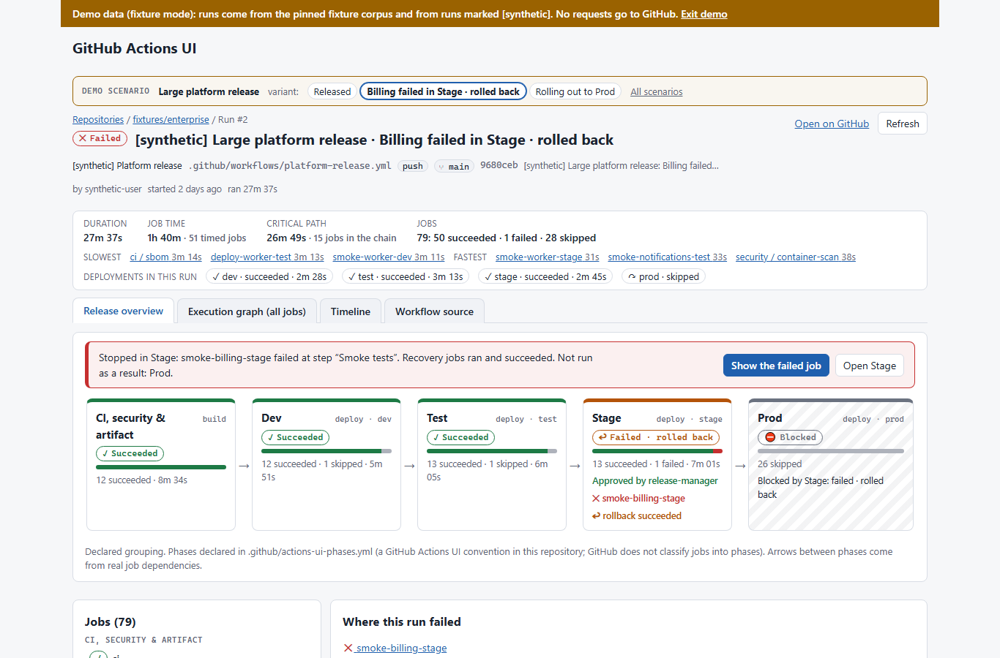
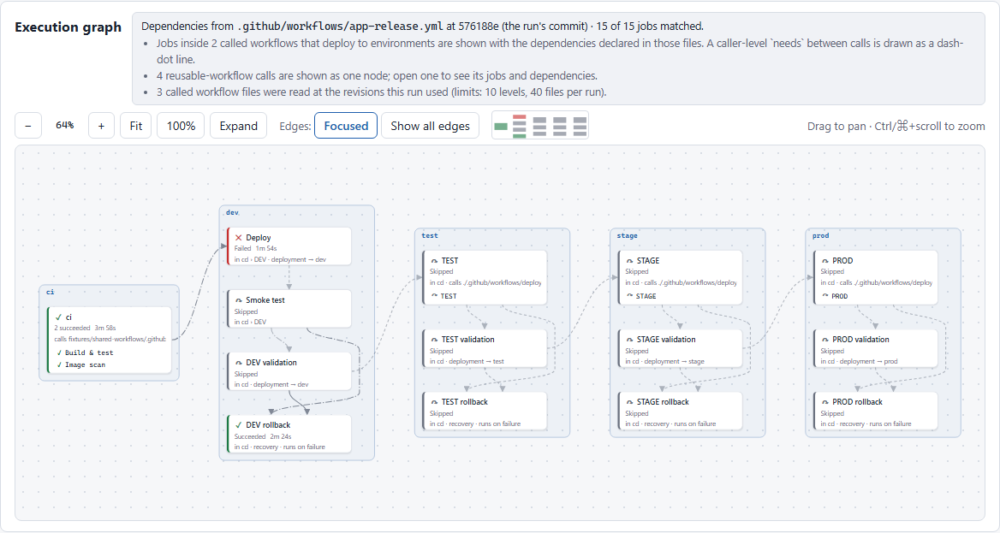
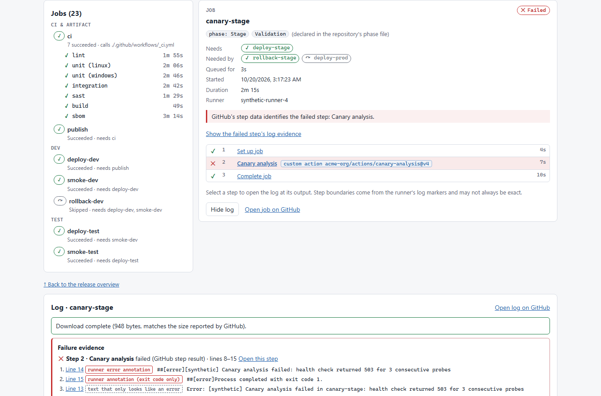
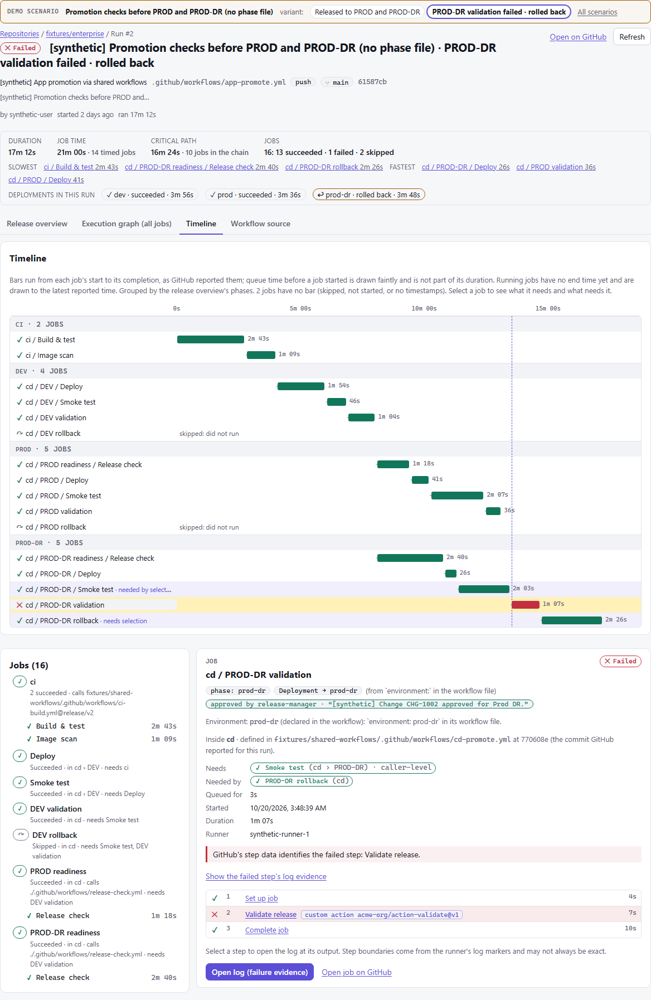

# GitHub Actions UI

**A clearer way to see your GitHub Actions workflow runs: how a release moved through its environments, which job failed and why, and the exact log line that explains it.**

[](https://github.com/GauJosh/github-actions-ui/actions/workflows/ci.yml)
[](https://github.com/GauJosh/github-actions-ui/actions/workflows/e2e.yml)
[](LICENSE)


GitHub Actions UI is an open-source viewer and dashboard for **GitHub Actions** workflow runs, pipelines and logs. It runs entirely in your browser and reads data from GitHub's REST API. It never changes anything, and there is no server, database or telemetry.



<sub>All screenshots use the built-in synthetic demo data.</sub>

---

## Why it exists

GitHub's own Actions page is fine for a five-job CI run. It gets hard to use when a workflow becomes a real delivery pipeline:

- **Reusable workflows inside reusable workflows.** Jobs appear as `cd / PROD / Smoke test`, and the structure that produced them is hidden.
- **Many environments.** It is hard to see at a glance how far a release got: Dev passed, Stage failed, Prod never ran.
- **Huge logs.** The one line that matters sits somewhere in 50,000 lines, often after a misleading "error" that wasn't one.
- **Re-runs.** "Attempt 3" succeeded, but what went wrong in attempts 1 and 2?
- **Timing.** What ran in parallel, what waited, and what made the run slow?

This tool answers those questions from the data GitHub already has. GitHub remains the source of truth.

## What it does

| | |
|---|---|
| **Release overview** | Your run's phases at a glance: CI, each deployment environment, approval gates, rollbacks. It shows where the run stopped and why. Phases come from your workflow's own `environment:` settings, or from an optional phase file. |
| **Execution graph** | Every job and the real `needs:` dependencies from the workflow file, at the commit the run used. Reusable workflows are expanded across repositories. Matrix legs are grouped. Nothing is guessed from timing. |
| **Failure evidence** | The failed step, GitHub's error annotations, error signatures and stack traces, ranked so the real cause comes first. One click opens the log at that line. |
| **Fast log viewer** | The end of the log appears first; the full log streams in a background worker. It has search, errors-only view, step sections and shareable line links, and it stays usable for very large logs. |
| **Timeline** | A Gantt-style chart of every job on one time axis: queue time, parallel work, the critical path, and what each job waited for. |
| **Run attempts** | Switch between attempt 1, 2, 3… of a re-run workflow. Each attempt shows its own jobs, results, timings and logs. |
| **Workflow source** | The workflow files and called workflows the run used, at their exact revisions, with inputs. Values that look like secrets are hidden. |
| **Run statistics** | Duration, total job time, slowest jobs and the deployments in the run. |
| **Failure impact** | For each failure: what it needed, which jobs did not run because of it, and which ran anyway. Jobs skipped by their own conditions are kept apart. |
| **Compare runs** | This run against a previous success or another attempt: jobs that changed outcome, renamed or added jobs, slower jobs, commits, workflow-file and dependency changes, and a log diff for any job. |
| **Search** | One field across job and step names, workflow source, failures and the logs of the jobs you choose, saying exactly how much of each log was searched. |

<details>
<summary><b>More screenshots</b></summary>

**Execution graph** of a release built from shared, nested reusable workflows:



**Failed step and log** with ranked failure evidence:



**Timeline** with the selected job's dependencies highlighted:



</details>

## Quick start

You need **Git** and **Node.js 22.18 or later** (LTS recommended). The steps are the same on every platform once Node is installed.

### 1. Install Node.js and Git

<details open>
<summary><b>Windows</b> (PowerShell)</summary>

```powershell
winget install OpenJS.NodeJS.LTS
winget install Git.Git
# open a new terminal so both are on PATH
node --version
```
</details>

<details>
<summary><b>macOS</b> (Homebrew)</summary>

```bash
brew install node git
node --version
```
</details>

<details>
<summary><b>Linux</b> (any distribution, via nvm)</summary>

```bash
curl -o- https://raw.githubusercontent.com/nvm-sh/nvm/v0.40.3/install.sh | bash
source ~/.nvm/nvm.sh
nvm install --lts
node --version
```

Install Git with your package manager, e.g. `sudo apt install git` or `sudo dnf install git`.
</details>

### 2. Get the app and run it

These commands work as-is in PowerShell, Terminal and bash:

```bash
git clone https://github.com/GauJosh/github-actions-ui.git
cd github-actions-ui
npm ci
npm run fixtures:fetch   # demo data: downloads a pinned, checksum-verified sample set
npm run dev
```

Open **http://localhost:5173**.

### 3. Try it without a token

Choose **Or explore with demo data** on the connect screen, or open http://localhost:5173/?mode=fixtures. A gallery of realistic CI/CD scenarios is available: multi-environment releases, approval gates, rollbacks, an 80-job platform release, re-run attempts and nested reusable workflows. Demo mode never contacts GitHub.

### 4. Connect to your own repositories

1. On GitHub, go to **Settings → Developer settings → Personal access tokens → Fine-grained tokens → Generate new token**.
2. Choose the repositories you want to inspect, and grant these **read-only** repository permissions:
   - **Actions: Read**
   - **Contents: Read** (to read workflow files)
   - **Metadata: Read**
3. Paste the token into the app.

The token stays in browser memory only. It is never saved, logged or put in a URL; reloading the page or choosing **Disconnect** forgets it.

### Run a production build instead

For everyday use, the production build is smaller and is served with a strict Content Security Policy:

```bash
npm run build
npm run preview    # http://localhost:4173
```

## How to use it

**Open a failing run directly.** Paste any run, job or attempt URL from GitHub into the home screen:

```text
https://github.com/OWNER/REPO/actions/runs/123456789
https://github.com/OWNER/REPO/actions/runs/123456789/job/987654321
https://github.com/OWNER/REPO/actions/runs/123456789/attempts/2
```

**Or find a repository.** Type part of its name, `org/` to search within one organisation, or an exact `org/repo` and press Enter. GitHub's search covers every repository your token can see, even thousands. Then filter its runs by status, branch, event or workflow.

**Then, inside a run:**

- Start with the **Release overview**. A red banner says where the run stopped. **Show the failed job** jumps to it.
- In the job, the failed step is marked. **Open log (failure evidence)** opens the log at the line that explains the failure.
- Switch to the **Execution graph** to see the full dependency structure, or the **Timeline** to see where the time went.
- If the run was re-run, pick an **attempt** under the run title to inspect an earlier one.
- **Workflow source** shows exactly which workflow files, and which revisions of them, produced the run.
- **Investigate failure** outlines each failure's path on the graph. **Compare** sets this run against a previous success or another attempt, and **Search** finds a message across jobs, steps and logs.

Every view, job, step and log line has its own URL, so you can paste a link to the exact failing line into a chat or an issue. Links contain no credentials.

### Optional: name your phases

Phases are inferred from `environment:` in your workflows. To name them yourself, or to group CI jobs, add `.github/actions-ui-phases.yml` to your repository. This is a convention of this app, not a GitHub feature. See [`docs/ARCHITECTURE.md`](docs/ARCHITECTURE.md) for the format.

## Security and privacy

- **Read-only by construction.** Every request goes through one transport that allows only `GET` and `HEAD`, and only to `api.github.com`; log downloads follow GitHub's own redirect to its log storage. There is no code to re-run, cancel or approve anything.
- **Your token stays in memory.** It is not written to local storage, cookies or URLs, and it is sent only to the GitHub API.
- **Nothing leaves your machine except requests to GitHub.** There is no backend, analytics or telemetry.
- **Log parsing is isolated** in a Web Worker with no network access. A strict Content Security Policy applies in production builds.
- **Secrets stay hidden.** Workflow inputs that reference secrets or look like credentials are redacted in the source view.

## FAQ

**Is this a replacement for GitHub's Actions tab?**
No. It is a companion for understanding and troubleshooting runs; every view links back to GitHub.

**Does it work with GitHub Enterprise Server?**
Not yet. It currently talks to `api.github.com` only.

**Does it need a server or a GitHub App?**
No. It is a static web app. Run it locally, or host the `dist/` folder on any static web server.

**Why does it ask for Contents: Read?**
To read your workflow files at the commit each run used. That is where the real job dependencies come from.

**What about logs that GitHub has already deleted?**
The app says the log has expired. It never fills the gap with guessed or sample data.

## For contributors

| Command | What it does |
|---|---|
| `npm run dev` | Development server with demo mode |
| `npm run build` | Typecheck and production build (demo mode is compiled out) |
| `npm run preview` | Serve the production build with the production CSP |
| `npm run lint` / `npm run typecheck` | ESLint (with module-boundary rules) / TypeScript |
| `npm test` | Unit and contract tests (Vitest). Outbound network is blocked, and GitHub is mocked |
| `npx playwright install chromium` then `npm run e2e` | Browser tests against a demo-enabled test build |

**Demo and test data.** It comes from the [`gha-ui-fixtures`](https://github.com/GauJosh/gha-ui-fixtures) corpus, pinned by commit in `fixtures.lock.json`, plus clearly labelled `[synthetic]` scenarios generated locally.
- `npm run fixtures:fetch` checks every file's size and SHA-256, and fails loudly on any mismatch.
- To work offline, fetch once while online, or copy from a local clone: `npm run fixtures:fetch -- --from ../gha-ui-fixtures`.
- To re-pin the corpus, which is a reviewed change: `npm run fixtures:lock -- --commit <sha> --from ../gha-ui-fixtures`.

**About "integrity".** The log viewer checks that a download is *complete*: byte counts match and no ranges are missing. GitHub publishes no checksum for logs, so log content cannot be cryptographically verified by the client.

Design notes and decisions are in [`docs/ARCHITECTURE.md`](docs/ARCHITECTURE.md), and planned work is in [`docs/ROADMAP.md`](docs/ROADMAP.md). Issues and pull requests are welcome.

## License

[Apache-2.0](LICENSE)

---

<sub>Keywords: GitHub Actions UI, GitHub Actions dashboard, GitHub Actions workflow visualizer, CI/CD pipeline viewer, GitHub Actions log viewer, reusable workflow graph, deployment environments, workflow run timeline.</sub>
