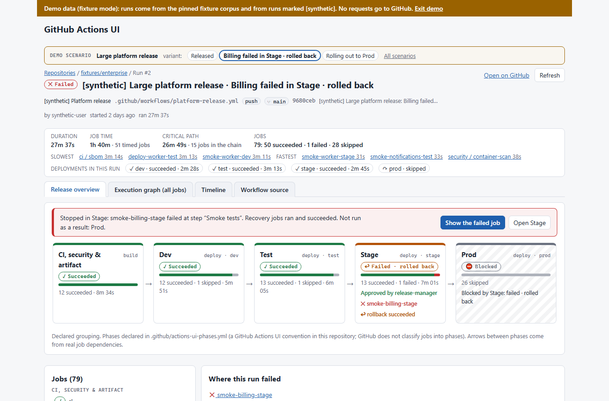
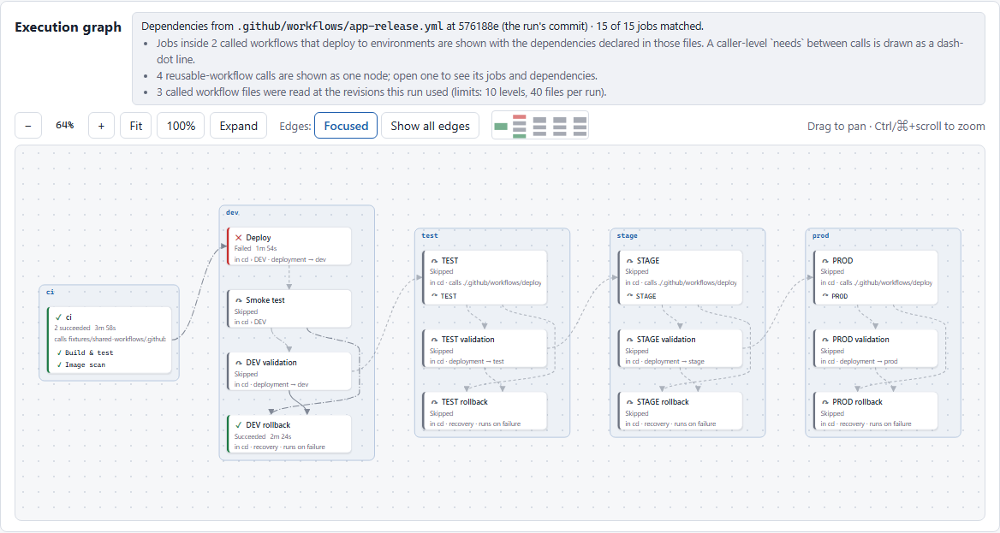
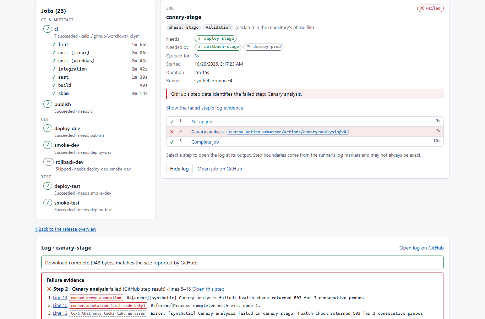
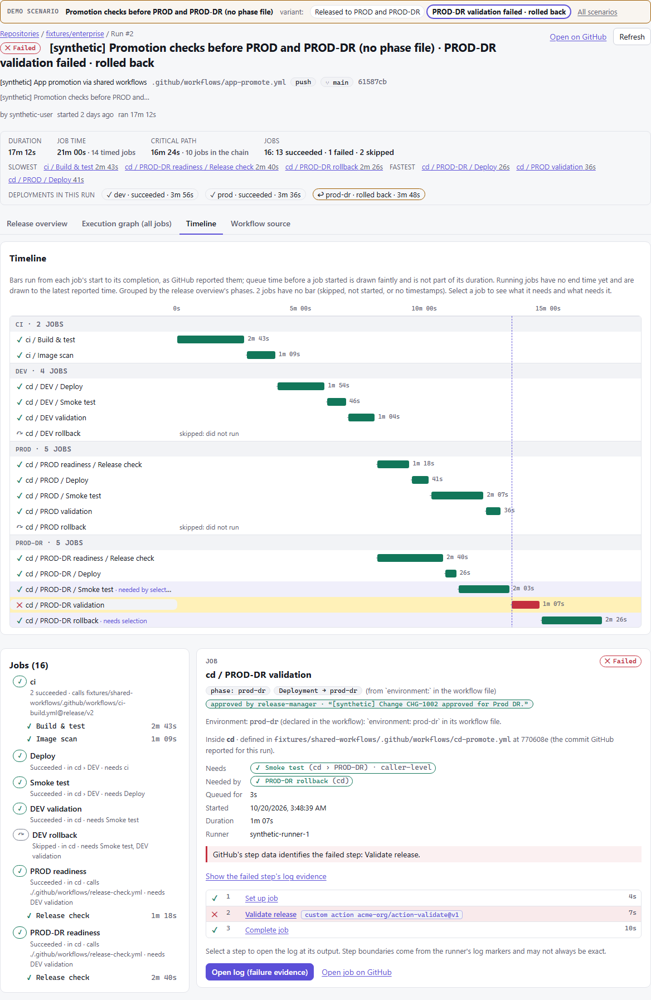
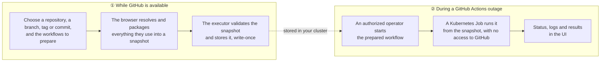

# GitHub Actions UI

**A clearer way to see your GitHub Actions workflow runs: how a release moved through its environments, which job failed and why, and the exact log line that explains it. Plus an optional way to run prepared workflows on your own Kubernetes cluster when GitHub Actions is down.**

[](https://github.com/GauJosh/github-actions-ui/actions/workflows/ci.yml)
[](https://github.com/GauJosh/github-actions-ui/actions/workflows/e2e.yml)
[](LICENSE)


GitHub Actions UI is an open-source viewer and dashboard for **GitHub Actions** workflow runs, pipelines and logs. It has two parts:

- **The investigation views**, the main app. They run entirely in your browser and read data from GitHub's REST API, read-only. They never change anything, and they need no server, database or telemetry.
- **[Emergency Execution](#emergency-execution)**, an optional component you install on your own Kubernetes cluster. It runs prepared workflows when GitHub Actions is unavailable. It is implemented and tested locally, and **not yet deployed as a production service** (see [Project status](#project-status)).

It is a companion to GitHub Actions, not a replacement. GitHub stays the source of truth, and nothing is written back to it.



<sub>All screenshots use the built-in synthetic demo data.</sub>

---

## Why it exists

GitHub's own Actions page is fine for a five-job CI run. It gets hard to use when a workflow becomes a real delivery pipeline:

- **Reusable workflows inside reusable workflows.** Jobs appear as `cd / PROD / Smoke test`, and the structure that produced them is hidden.
- **Many environments.** It is hard to see at a glance how far a release got: Dev passed, Stage failed, Prod never ran.
- **Huge logs.** The one line that matters sits somewhere in 50,000 lines, often after a misleading "error" that wasn't one.
- **Re-runs.** "Attempt 3" succeeded, but what went wrong in attempts 1 and 2?
- **Timing.** What ran in parallel, what waited, and what made the run slow?

This tool answers those questions from the data GitHub already has. GitHub remains the source of truth.

And when GitHub Actions itself is down, an urgent fix or release can be stuck until it recovers. Emergency Execution is for that case: workflows you prepared in advance can still run on infrastructure you control.

**Who it's for:**
- **Investigation views:** anyone who maintains or debugs GitHub Actions workflows, from a small open-source project to an organisation's release pipelines.
- **Emergency Execution:** platform and release engineers who run Kubernetes, and who want a fallback for a few important workflows during an outage.

## Key features

**Investigation views** (read-only, in your browser):

| | |
|---|---|
| **Release overview** | Your run's phases at a glance: CI, each deployment environment, approval gates, rollbacks. It shows where the run stopped and why. Phases come from your workflow's own `environment:` settings, or from an optional phase file. |
| **Execution graph** | Every job and the real `needs:` dependencies from the workflow file, at the commit the run used. Reusable workflows are expanded across repositories. Matrix legs are grouped. Nothing is guessed from timing. |
| **Failure evidence** | The failed step, GitHub's error annotations, error signatures and stack traces, ranked so the real cause comes first. One click opens the log at that line. |
| **Fast log viewer** | The end of the log appears first; the full log streams in a background worker. It has search, errors-only view, step sections and shareable line links, and it stays usable for very large logs. |
| **Timeline** | A Gantt-style chart of every job on one time axis: queue time, parallel work, the critical path, and what each job waited for. |
| **Run attempts** | Switch between attempt 1, 2, 3… of a re-run workflow. Each attempt shows its own jobs, results, timings and logs. |
| **Workflow source** | The workflow files and called workflows the run used, at their exact revisions, with inputs. Values that look like secrets are hidden. |
| **Run statistics** | Duration, total job time, slowest jobs and the deployments in the run. |
| **Failure impact** | For each failure: what it needed, which jobs did not run because of it, and which ran anyway. Jobs skipped by their own conditions are kept apart. |
| **Compare runs** | This run against a previous success or another attempt: jobs that changed outcome, renamed or added jobs, slower jobs, commits, workflow-file and dependency changes, and a log diff for any job. |
| **Search** | One field across job and step names, workflow source, failures and the logs of the jobs you choose, saying exactly how much of each log was searched. |
| **Repository dashboard and history** | Find any repository your token can see, then filter its runs by status, branch, event or workflow. Pipeline history and performance insights across runs, release, deployment and artifact evidence for a run, and shareable investigation reports. |

**Kubernetes deployment:** two Helm charts:
- [`charts/gha-ui`](charts/gha-ui/README.md) serves the investigation views, unchanged: they still call GitHub from the browser.
- [`charts/gha-emergency`](charts/gha-emergency/README.md) installs Emergency Execution.

See [Deploy on Kubernetes](#deploy-on-kubernetes).

**[Emergency Execution](#emergency-execution)** (optional): prepare immutable snapshots of important workflows while GitHub is available, and run them as Kubernetes Jobs, with no access to GitHub, if GitHub Actions becomes unavailable.

<details>
<summary><b>More screenshots</b></summary>

**Execution graph** of a release built from shared, nested reusable workflows:



**Failed step and log** with ranked failure evidence:



**Timeline** with the selected job's dependencies highlighted:



</details>

## Emergency Execution

**The problem.** During a GitHub Actions outage you can't run workflows: no runners, no actions downloads, no API. If a security fix or a release has to go out, the pipeline that normally does it is unavailable.

**The idea.** Prepare in advance, while GitHub works; run later, when it doesn't. The two phases never overlap: preparation is the only part that talks to GitHub.



**Step by step:**
1. **Select.** While GitHub is available, sign in to the emergency view, choose a repository, a branch, tag or commit, and the workflows to prepare. The ref is pinned to an exact commit.
2. **Package.** The browser, using your read-only GitHub token, resolves what those workflows depend on, and packages it into a **snapshot**: one immutable bundle, identified by the SHA-256 digest of its manifest, in which every file is pinned by hash. That covers reusable workflows, local and external actions (at pinned commits), composite and JavaScript actions, and the scripts they run. Anything that can't run without GitHub is reported as an error, and a snapshot with errors can't be run.
3. **Store.** The snapshot is uploaded to the **executor**, a service in your cluster. The executor validates it again, independently, and stores it read-only on its own volume. Secret values are never part of a snapshot: it records only which secrets the workflows need.
4. **Run.** If GitHub Actions becomes unavailable, an operator signed in to the executor starts the prepared workflow, with its declared inputs. Sensitive executions wait for a second person's approval.
5. **Execute.** A Kubernetes Job (the **runner**) mounts the snapshot read-only and runs the jobs and steps in dependency order. Actions and scripts come from the snapshot: nothing is downloaded from GitHub, and the runner has no GitHub token.
6. **Review.** The UI shows the execution's status, jobs and steps with exit codes, logs, outputs and the final result. Nothing is reported back to GitHub; reconcile by hand once it recovers.

The full design, and the steps to run it, are in [`docs/EMERGENCY_EXECUTION.md`](docs/EMERGENCY_EXECUTION.md).

### What you need

- A Kubernetes cluster, version **1.30 or later**, that you control. For isolated executions, its network plugin must **enforce NetworkPolicy**, for example Calico or Cilium; the executor checks this itself.
- The executor and runner images, built from [`deploy/emergency/Dockerfile`](deploy/emergency/Dockerfile) and available on your nodes, or in a registry that doesn't depend on GitHub.
- For sign-in, an **OpenID Connect identity provider** that doesn't depend on GitHub (it has to work during the outage), or break-glass accounts.
- Snapshots prepared **before** the outage. Preparation needs GitHub and a read-only token, so it can't happen during one.

### Security

Emergency Execution runs code, so it is built to limit what anyone, including the workflows themselves, can do. It is **not** certified for production, and known findings are still open (below).

- **Sign-in and roles.** Each person signs in with your organisation's OpenID Connect provider, and the executor keeps their session. Roles decide what they can do:
  - **viewer:** see snapshots, executions and logs;
  - **operator:** prepare snapshots and start executions;
  - **approver:** approve sensitive executions;
  - **administrator:** manage users' roles and sessions, suspend Secret bindings, read the audit log.

  Roles are assigned in the executor, never taken from the sign-in token, and nobody can change their own. Optional break-glass accounts cover an identity-provider outage. Every sign-in, refusal and action is recorded in an audit log, with who did it.
- **Snapshot integrity.** A snapshot's identity is its content's digest, so it can't change without becoming a different snapshot. The executor re-validates every upload itself, rather than trusting the browser's analysis. Stored files are re-verified before each execution, and again inside the runner.
- **Approval.** Executions that receive a Secret, or that have network access, wait for an approver by default. The approval covers exactly what will run, so any change to it voids the approval. By default, the approver can't be the person who started the execution or prepared the snapshot.
- **Job isolation.** Each execution is a Kubernetes Job:
  - no Kubernetes credentials;
  - not root, read-only root filesystem, no added capabilities;
  - limited CPU, memory, disk and time.

  An admission policy in the Kubernetes API server rejects any Job in the emergency namespace that doesn't match that shape, whoever creates it. The executor checks that the policy is actually enforced before running anything.
- **Network isolation.** Executions are isolated by default: a NetworkPolicy denies all traffic in and out. Before isolated runs, the executor proves the policy works with a test pod, and refuses to run if it doesn't.
- **Secrets.** Secret values are never packaged into snapshots. They live in a Kubernetes Secret, which a cluster administrator binds to an exact snapshot digest. Only the keys that snapshot needs are mounted, at execution time, and their values are masked in the logs.
- **No GitHub token.** Your GitHub token stays in your browser and is used only to read while preparing. The executor and the runner never receive it.
- **Trustworthy results.** The runner signs every event it reports, with a key that exists only in its own memory, out of reach of the workflow's processes. A result that was forged or tampered with is reported as an error, never as success.

What was found, fixed and is still open: [`docs/EMERGENCY_EXECUTION_SECURITY_REVIEW.md`](docs/EMERGENCY_EXECUTION_SECURITY_REVIEW.md). The medium findings M1–M7 are still open. Two examples: output from one step can be interpolated into a later step's script, and secret masking only catches exact matches.

### Compatibility and limitations

This is **not** a GitHub Actions runner, and it does not run every workflow. It runs a documented subset. Anything outside it is refused when the snapshot is validated, so you find out while preparing, not during the outage.

**Supported:**
- `workflow_dispatch` and `workflow_call` inputs; runs are started by hand.
- Jobs with `needs`, and `if:` with the status functions.
- Job and step outputs, `env`, `GITHUB_ENV` and `GITHUB_PATH`.
- Reusable workflows, local or external, nested.
- Composite actions, and JavaScript actions with their dependencies bundled (they run on Node 22).
- `actions/checkout` of the snapshot's own repository (it is replaced by the packaged files).
- `run:` steps in bash, sh or Python.
- Secrets from a Kubernetes Secret, `vars.*`, and step and job timeouts.
- An expression subset.

**Refused**, among others:
- matrix strategies;
- Docker and container actions, `container:` and service containers;
- artifacts and caches;
- `setup-*` actions, which download toolchains;
- `GITHUB_TOKEN`, OIDC tokens and `github.event` payloads;
- PowerShell and cmd;
- `hashFiles`.

**Behaves differently:**
- Jobs run **one at a time**, in dependency order, each with a fresh copy of the workspace.
- Triggers, `runs-on`, environments and their protection rules, `permissions:` and `concurrency:` are ignored, with a warning.
- Everything runs in one generic runner image: Node 22, bash, sh and Python 3 (standard library only). Package installs fail in isolated mode, so dependencies must be in the repository.
- Steps that call GitHub (its API, `gh`, `git clone/fetch/push`) can't work.

The full table is in [Compatibility](docs/EMERGENCY_EXECUTION.md#6-github-actions-compatibility), and other gaps in [Known gaps](docs/EMERGENCY_EXECUTION.md#9-known-gaps). Two that matter:
- Snapshots are stored on one volume attached to the executor's node.
- Results are not reported back to GitHub.

### Project status

Emergency Execution is **implemented and tested, but not deployed as a production service**, and it has **never been used during a real GitHub outage**.

- **Automated and local testing** (2026-11-02):
  - unit and browser tests, with the browser tests using a mocked executor;
  - the runner image checked in containers, including a hostile workflow that tries to forge its results;
  - the Kubernetes admission policy checked against throwaway API servers (Kubernetes 1.30 and 1.35), with 51 malicious Job specifications.
- **Live cluster runs** (local minikube, 2026-10-30), with GitHub blocked from the Job to simulate the outage:
  - the first version ran a demo pipeline end to end, from the UI to a Kubernetes Job;
  - Secret isolation and network isolation were then validated on a separate profile running Calico.
- **Not live-tested yet:**
  - the current version, with sign-in, approvals, admission enforcement and signed results, has not been deployed to any cluster;
  - sign-in has been tested only against a development identity provider, not a real one;
  - the custom ID-token verification code still needs a focused security review;
  - a full preparation of a real repository has not been done (the demo uses built-in sample data).

The remaining work is tracked in [`docs/ROADMAP.md`](docs/ROADMAP.md).

## Quick start

You need **Git** and **Node.js 22.18 or later** (LTS recommended). The steps are the same on every platform once Node is installed.

### 1. Install Node.js and Git

<details open>
<summary><b>Windows</b> (PowerShell)</summary>

```powershell
winget install OpenJS.NodeJS.LTS
winget install Git.Git
# open a new terminal so both are on PATH
node --version
```
</details>

<details>
<summary><b>macOS</b> (Homebrew)</summary>

```bash
brew install node git
node --version
```
</details>

<details>
<summary><b>Linux</b> (any distribution, via nvm)</summary>

```bash
curl -o- https://raw.githubusercontent.com/nvm-sh/nvm/v0.40.3/install.sh | bash
source ~/.nvm/nvm.sh
nvm install --lts
node --version
```

Install Git with your package manager, e.g. `sudo apt install git` or `sudo dnf install git`.
</details>

### 2. Get the app and run it

These commands work as-is in PowerShell, Terminal and bash:

```bash
git clone https://github.com/GauJosh/github-actions-ui.git
cd github-actions-ui
npm ci
npm run fixtures:fetch   # demo data: downloads a pinned, checksum-verified sample set
npm run dev
```

Open **http://localhost:5173**.

### 3. Try it without a token

Choose **Or explore with demo data** on the connect screen, or open http://localhost:5173/?mode=fixtures. A gallery of realistic CI/CD scenarios is available: multi-environment releases, approval gates, rollbacks, an 80-job platform release, re-run attempts and nested reusable workflows. Demo mode never contacts GitHub.

### 4. Connect to your own repositories

1. On GitHub, go to **Settings → Developer settings → Personal access tokens → Fine-grained tokens → Generate new token**.
2. Choose the repositories you want to inspect, and grant these **read-only** repository permissions:
   - **Actions: Read**
   - **Contents: Read** (to read workflow files)
   - **Metadata: Read**
3. Paste the token into the app.

The token stays in browser memory only. It is never saved, logged or put in a URL; reloading the page or choosing **Disconnect** forgets it.

### Run a production build instead

For everyday use, the production build is smaller and is served with a strict Content Security Policy:

```bash
npm run build
npm run preview    # http://localhost:4173
```

## How to use it

**Open a failing run directly.** Paste any run, job or attempt URL from GitHub into the home screen:

```text
https://github.com/OWNER/REPO/actions/runs/123456789
https://github.com/OWNER/REPO/actions/runs/123456789/job/987654321
https://github.com/OWNER/REPO/actions/runs/123456789/attempts/2
```

**Or find a repository.** Type part of its name, `org/` to search within one organisation, or an exact `org/repo` and press Enter. GitHub's search covers every repository your token can see, even thousands. Then filter its runs by status, branch, event or workflow.

**Then, inside a run:**

- Start with the **Release overview**. A red banner says where the run stopped. **Show the failed job** jumps to it.
- In the job, the failed step is marked. **Open log (failure evidence)** opens the log at the line that explains the failure.
- Switch to the **Execution graph** to see the full dependency structure, or the **Timeline** to see where the time went.
- If the run was re-run, pick an **attempt** under the run title to inspect an earlier one.
- **Workflow source** shows exactly which workflow files, and which revisions of them, produced the run.
- **Investigate failure** outlines each failure's path on the graph. **Compare** sets this run against a previous success or another attempt, and **Search** finds a message across jobs, steps and logs.

Every view, job, step and log line has its own URL, so you can paste a link to the exact failing line into a chat or an issue. Links contain no credentials.

### Optional: name your phases

Phases are inferred from `environment:` in your workflows. To name them yourself, or to group CI jobs, add `.github/actions-ui-phases.yml` to your repository. This is a convention of this app, not a GitHub feature. See [`docs/ARCHITECTURE.md`](docs/ARCHITECTURE.md) for the format.

## Deploy on Kubernetes

The two charts are independent, and no image is published to a registry: you build them from this repository. Both charts have been installed on minikube (Kubernetes 1.35, CRI-O, Podman). For Emergency Execution, that was an earlier version; see [Project status](#project-status).

**Investigation views** ([`charts/gha-ui`](charts/gha-ui/README.md)): a static server for the production build. It needs Kubernetes 1.25 or later and Helm 3. Build and load the image as the chart's README describes, then:

```sh
kubectl create namespace gha-ui
kubectl label namespace gha-ui pod-security.kubernetes.io/enforce=restricted
helm install gha-ui charts/gha-ui --namespace gha-ui --wait
```

**Emergency Execution** ([`charts/gha-emergency`](charts/gha-emergency/README.md)) has more prerequisites:
- Kubernetes 1.30 or later, and a network plugin that enforces NetworkPolicy.
- A **dedicated** namespace that enforces Pod Security `restricted`. The chart refuses to install into any other.
- Permission to create cluster-scoped admission policies.
- The two images (the `executor` and `runner` targets of [`deploy/emergency/Dockerfile`](deploy/emergency/Dockerfile)). The runner is referenced by its **digest**.
- A sign-in method: your OpenID Connect provider (`auth.oidc`, with your first administrator in `auth.initialAdministrators`) and/or break-glass accounts.
- A separate **trusted UI origin** (`ui.trustedUiUrl`) where the GitHub token is entered — the investigation app served by the `gha-ui` chart or any static host. The executor never serves the token UI (security review M5); it serves only the execution console and forbids GitHub connectivity in its CSP.

The outline:

```sh
kubectl create namespace gha-emergency
kubectl label namespace gha-emergency pod-security.kubernetes.io/enforce=restricted gha-emergency.github-actions-ui/dedicated=true
helm install gha-emergency charts/gha-emergency -n gha-emergency \
  --set executor.image.digest=sha256:<executor-digest> --set runner.image.digest=sha256:<runner-digest> \
  --set auth.oidc.issuer=<issuer URL> --set auth.oidc.clientId=<client ID> \
  --set auth.oidc.redirectUri=https://<host>/api/emergency/auth/callback \
  --set "auth.initialAdministrators[0].issuer=<issuer URL>" --set "auth.initialAdministrators[0].subject=<your subject>" \
  --set ui.trustedUiUrl=https://<trusted-gha-ui-host>
```

Secrets for snapshots are created and bound to snapshot digests after preparation, with `secretBindings`. The full tested sequence is in [Run the MVP locally](docs/EMERGENCY_EXECUTION.md#10-run-the-mvp-locally-windows-with-podman-and-minikube-as-tested): building and loading the images, finding both images' digests (executor and runner), break-glass accounts for a cluster without an identity provider, binding a Secret, and migrating from the old shared operator token.

## Security and privacy

These points are about the investigation views. Emergency Execution's protections are described [above](#security).

- **Read-only by construction.** Every request goes through one transport that allows only `GET` and `HEAD`, and only to `api.github.com`; log downloads follow GitHub's own redirect to its log storage. There is no code to re-run, cancel or approve anything on GitHub.
- **Your token stays in memory.** It is not written to local storage, cookies or URLs, and it is sent only to the GitHub API.
- **Nothing leaves your machine except requests to GitHub.** There is no backend, analytics or telemetry. (Emergency Execution, if you install it, adds its own executor service in your cluster. Your GitHub token is never sent to it.)
- **Log parsing is isolated** in a Web Worker with no network access. A strict Content Security Policy applies in production builds.
- **Secrets stay hidden.** Workflow inputs that reference secrets or look like credentials are redacted in the source view.

## FAQ

**Is this a replacement for GitHub's Actions tab, or for GitHub Actions?**
No. The investigation views are a companion for understanding and troubleshooting runs, and every view links back to GitHub. Emergency Execution is a fallback for a few prepared workflows during an outage. It runs a subset of GitHub Actions features and reports nothing back to GitHub.

**Does it work with GitHub Enterprise Server?**
Not yet. It currently talks to `api.github.com` only.

**Does it need a server or a GitHub App?**
The investigation views don't: they are a static web app. Run it locally, host the `dist/` folder on any static web server, or use the `gha-ui` chart. No GitHub App is needed. Emergency Execution is the exception: it needs its executor service and a Kubernetes cluster.

**Can I try Emergency Execution without a cluster?**
Not fully. The emergency view needs a running executor; without one, it says so. The repository includes a demo pipeline (`examples/emergency-demo`), which demo mode serves as a simulated GitHub repository. [Run the MVP locally](docs/EMERGENCY_EXECUTION.md#10-run-the-mvp-locally-windows-with-podman-and-minikube-as-tested) runs it on minikube.

**Why does it ask for Contents: Read?**
To read your workflow files at the commit each run used. That is where the real job dependencies come from.

**What about logs that GitHub has already deleted?**
The app says the log has expired. It never fills the gap with guessed or sample data.

## For contributors

| Command | What it does |
|---|---|
| `npm run dev` | Development server with demo mode |
| `npm run build` | Typecheck and production build (demo mode is compiled out) |
| `npm run preview` | Serve the production build with the production CSP |
| `npm run lint` / `npm run typecheck` | ESLint (with module-boundary rules) / TypeScript |
| `npm test` | Unit and contract tests (Vitest). Outbound network is blocked, and GitHub is mocked |
| `npx playwright install chromium` then `npm run e2e` | Browser tests against a demo-enabled test build |

**Demo and test data.** It comes from the [`gha-ui-fixtures`](https://github.com/GauJosh/gha-ui-fixtures) corpus, pinned by commit in `fixtures.lock.json`, plus clearly labelled `[synthetic]` scenarios generated locally.
- `npm run fixtures:fetch` checks every file's size and SHA-256, and fails loudly on any mismatch.
- To work offline, fetch once while online, or copy from a local clone: `npm run fixtures:fetch -- --from ../gha-ui-fixtures`.
- To re-pin the corpus, which is a reviewed change: `npm run fixtures:lock -- --commit <sha> --from ../gha-ui-fixtures`.

**About "integrity".** The log viewer checks that a download is *complete*: byte counts match and no ranges are missing. GitHub publishes no checksum for logs, so log content cannot be cryptographically verified by the client.

**Emergency Execution checks** that need more than `npm test` (container and cluster runs) are listed in [Run the MVP locally](docs/EMERGENCY_EXECUTION.md#10-run-the-mvp-locally-windows-with-podman-and-minikube-as-tested). They include the runner check, the runner attack check and the admission-policy check (`tools/emergency/`).

**Documentation:**
- [`docs/ARCHITECTURE.md`](docs/ARCHITECTURE.md): design notes and decisions.
- [`docs/ROADMAP.md`](docs/ROADMAP.md): planned work and status.
- [`docs/EMERGENCY_EXECUTION.md`](docs/EMERGENCY_EXECUTION.md): Emergency Execution's design, compatibility, security model and run steps.
- [`docs/EMERGENCY_EXECUTION_SECURITY_REVIEW.md`](docs/EMERGENCY_EXECUTION_SECURITY_REVIEW.md): its security review and remediation log.
- [`charts/gha-ui`](charts/gha-ui/README.md) and [`charts/gha-emergency`](charts/gha-emergency/README.md): the Helm charts.

Issues and pull requests are welcome.

## License

[Apache-2.0](LICENSE)

---

<sub>Keywords: GitHub Actions UI, GitHub Actions dashboard, GitHub Actions workflow visualizer, CI/CD pipeline viewer, GitHub Actions log viewer, reusable workflow graph, deployment environments, workflow run timeline, GitHub Actions outage, emergency workflow execution, Kubernetes Jobs.</sub>
