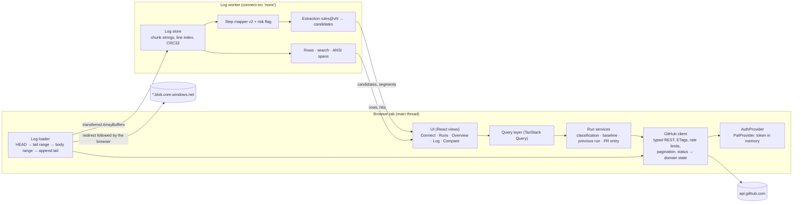

# Architecture — GitHub Actions UI

**Status:** Approved 2026-10-20. A1–A7 and A9 are approved; **A8 is approved provisionally**. **No application code exists.**

**Sources:**
- Milestones: `docs/ROADMAP.md` (in this repository).
- **Not in this repository.** These are maintained locally by the maintainer and are not published:
  - the **project brief**, which holds goals, MVP scope, success criteria, facts and assumptions (§7) and experiment results E1–E9 (§8);
  - the Phase 1 discovery report;
  - the Phase 2 UX proposal;
  - the reviewed architecture proposal (revision 3).
- This document restates the decisions and measurements it relies on, so it can be read on its own.
- Identifiers such as D1–D4, U1–U8, R1–R7, Q1–Q10, S1–S7 and E1–E9 are decision, question, criterion and experiment numbers from the project brief.

**Evidence notation** (as in the project brief):
- **[D]** decided in the project brief
- **[O]** observed in an experiment
- **[V]** verified against GitHub documentation
- **[A]** assumption, not yet tested

> **Secrets rule for this document and everything derived from it.** No tokens, signed URLs or signed-URL query parameters appear in documents, logs, test output, examples or error messages. Diagnostics record **hostnames only** (e.g. `productionresultssa<N>.blob.core.windows.net`), plus HTTP status, byte offsets and timings.

---

## 1. Summary

GitHub Actions UI is a **browser-only, read-only single-page app**. It has no backend, no database and no background service.

- **GitHub calls:** the tab calls GitHub's REST API directly, using a fine-grained personal access token that the user pastes in and that is held **in memory only**.
- **Log loading:** job logs are fetched by the main thread, starting with the tail, and their bytes are **transferred**, without copying, into a Web Worker.
- **Log processing:** the worker owns the log text, its line index, search, step mapping and evidence extraction.
- **Domain logic** is plain TypeScript with no DOM or network access, so the same code runs in the worker, in unit tests and in a Node evaluation harness.
- **Product rule:** the product shows evidence and never states a verified cause. Diagnostic candidates are always labelled as hypotheses. **[D]** R1, R6.

## 2. Constraints

| Constraint | Source |
|---|---|
| Web app. Chromium first, local development (`localhost`); static hosting deferred | **[D]** D2, Q1, Q6 |
| No backend, database, background services or OAuth exchange in v1 | **[D]** D3, U2 |
| Fine-grained personal access token (PAT), pasted by the user and held in memory only. Never in URLs, logs, source control, storage or committed config | **[D]** U1, Q4 |
| Token permissions are **provisional** until Q2 | **[D]** Q2 open |
| Read-only: no write API calls. Actions are deep links to GitHub | **[D]** D4, project brief §5.6 (local) |
| Evidence, not causal conclusions. Dispatch inputs are shown as unavailable and never inferred | **[D]** R1, R6, project brief §5.5 (local) |
| Chromium can call `api.github.com` and fetch per-job logs (redirect to blob storage, HEAD, explicit ranges) directly | **[O]** E1, E5, E8 |
| Signed log URLs live 605 s. Each retry through the API gets a fresh URL | **[O]** E9 (genuine expiry) |

## 3. Decisions

| ID | Decision | Status | Rationale and evidence |
|---|---|---|---|
| **A1** | **React 18 + Vite + TypeScript** | Approved | Largest ecosystem for virtualisation and testing. Heavy work is in the worker, so framework runtime cost is secondary **[O]** E5, E8 |
| **A2** | **Single package** with enforced folder boundaries | Approved | No second consumer yet. `src/domain` can be split out later (CLI, extension) |
| **A3** | **The main thread fetches logs and transfers the bytes to the worker.** The worker never sees the token and cannot fetch | Approved, **measured** | E8: every chunk was transferred without copying, with 0 main-thread long tasks and a main-thread window of about 0.3 MB **[O]** |
| **A4** | **No persistent caching in v1.** Memory only | Approved | Matches the token being held in memory, keeps private log content off disk, and leaves the U6 history extension path open |
| **A5** | **Ship a fixture mode** (a fake GitHub served from the fixture corpus) behind a visible "Demo data" banner | Approved | Development and E2E tests without a token. A safe demo before hosting exists |
| **A6** | **Hand-written, typed worker message protocol.** No RPC library | Approved | A small message set with explicit transfer lists |
| **A7** | **TanStack Query** over a custom GitHub client. ETags are handled inside the client | Approved | Request deduplication, retries and cache lifetimes without writing a cache |
| **A8** | **Large-log soft threshold: 44 MB.** Above it, loading the full log is opt-in; tail-first triage still works without it (§6.4) | **Approved provisionally** | A UX policy based on the largest real log tested (s09, 43.9 MB), **not a proven memory limit**. Worker memory grows with log size (≈ 1.09× at 44 MB) **[O]** E8. The threshold is one adjustable constant. Larger-log memory testing is future validation work (roadmap V4) |
| **A9** | **On worker failure, re-download from byte 0.** The main thread keeps no copy of the log | Approved, **measured** | E8: an injected crash recovered byte-exact, at the cost of about 32 MB downloaded twice **[O]**. Restart and progress are visible, and repeated failures end in an explicit, recoverable error state (§6.5) |

## 4. Components



| Module | Responsibility | Runs in | Pure |
|---|---|---|---|
| `auth` | `AuthProvider` interface. `PatProvider` keeps the token in one module-scoped variable, never in React state, storage, URLs or logs. Cleared on "Disconnect" and lost on reload | main | no |
| `github` | Typed REST client over `fetch`. Injects the auth header and handles ETags, `Link` pagination, rate-limit tracking, a concurrency cap, backoff, and mapping status codes to domain states. **Issues GET and HEAD only** | main | no |
| `runs` | Loads runs, attempts, jobs and steps. Contains non-success classification (R3), baseline tiers (E7), previous-run comparison (R7), PR entry by head SHA (Q5), and building the comparison | main | rules are pure |
| `logs/download` | Per-job log loading (§6): HEAD, tail range, body range, retry and resume, backpressure, the A8 threshold, A9 recovery | main | no |
| `logs/worker` | Chunked text store, line index, CRC32, rows with ANSI spans, search, scaled-scroll geometry. Hosts mapping and extraction | worker | mostly |
| `domain/mapping` | Step mapper v2, consistency checks C1–C4, risk flag | worker · Node | yes |
| `domain/extraction` | Versioned rule set, wrapper demotion, deduplication, ranking, grouping keys | worker · Node | yes |
| `domain/types` | Shared domain types (§5.3) | all | yes |
| `ui` | Views from the Phase 2 UX proposal (local), the virtualised log view, and an explicit component for every "unavailable" state | main | no |
| `fixture-mode` | A local fixture API (`tools/fixture-server`, mounted in the Vite dev and preview servers) serves the pinned corpus with GitHub-shaped routes, HEAD and byte ranges. The app reaches it through a fixture transport that refuses any other URL and sends no token (see §11.2) | server + main | no |

**Boundary rules, enforced by lint:**
- `src/domain` imports nothing from `ui`, `github`, `logs/download` or any browser API.
- Only `auth` reads the token.
- Only `github` and `logs/download` call `fetch`.

## 5. Interfaces

### 5.1 Auth and GitHub client

```ts
interface AuthProvider {
  authorize(headers: Headers): void;   // adds Authorization; the only place the token is read
  describe(): { kind: "pat"; expiresAt?: string };
  clear(): void;
}

type ApiFailure =
  | { kind: "auth-failed" }                                   // 401
  | { kind: "rate-limited"; resetAt: number }                 // 403/429 with rate-limit headers
  | { kind: "permission"; detail: string }                    // 403 from the API host (e.g. logs "admin rights")
  | { kind: "not-found-or-no-permission" }                    // 404 (private resources look like 404)
  | { kind: "expired" }                                       // 410
  | { kind: "network" };
```

- **ETags:** conditional requests use `If-None-Match`. Authenticated 304s don't count against the primary rate limit **[V][O]**. Log responses have no ETag **[O]** E3.
- **Concurrency and backoff:** at most 6 concurrent requests. Backoff honours `Retry-After` and `x-ratelimit-reset`.
- **Read-only guarantee:** a unit test asserts that only GET and HEAD are ever issued.

### 5.2 Worker protocol (A6)

The messages are hand-written discriminated unions. Every `ArrayBuffer` is sent in the transfer list.

| Direction | Message | Purpose |
|---|---|---|
| main → worker | `init {jobId, totalBytes}` | Start a log session |
| main → worker | `tail {buf}` | The retained tail; the worker extracts early evidence from it |
| main → worker | `bytes {buf}` | A body chunk in byte order |
| main → worker | `finish {appendTail}` | End of body; append the retained tail |
| main → worker | `rows {from, count}` · `search {q, cap, regex?, budgetMs?}` · `segments {apiSteps}` | Queries |
| worker → main | `ack {n}` | Credit return for backpressure |
| worker → main | `tailEvidence {...}` · `progress {bytes, lines}` · `ready {bytes, lines, crc32}` | Load events |
| worker → main | `rowsResult` · `searchResult` · `segmentsResult` · `candidates` | Query results |

A worker failure (an `error` event or an unexpected termination) is handled by A9 (§6.5).

### 5.3 Core domain types (sketch)

```ts
type Evidence = { source: "annotation" | "log-line" | "api-field"; ref: string; text: string };

type Outcome =
  | { kind: "failed" | "timed-out" | "cancelled-manual" | "cancelled-concurrency"; evidence: Evidence[] }
  | { kind: "cancelled-unknown" | "not-successful-unknown"; evidence: [] };

type Candidate = {           // a hypothesis, never a verified cause
  text: string; jobId: number; stepNumber?: number; line?: number; tailOffset?: number;
  evidenceType: "test-summary" | "compiler" | "exception" | "annotation" | "package-manager" | "timeout" | "generic";
  ruleId: string; rulesVersion: string; score: number;
};

type Problem = { key: string; candidates: Candidate[]; jobs: number[] };   // grouped across matrix legs

type StepSegment = { stepNumber: number; startLine: number; endLine: number };

type LogDoc = {
  jobId: number; bytesTotal?: number; bytesLoaded: number;
  status: "tail-only" | "loading" | "complete" | "incomplete" | "expired" | "unavailable" | "processing-failed";
  fullLoad: "automatic" | "opt-in";                  // A8
  restarts: number;                                  // A9
  segments?: StepSegment[];
  mapping: "exact-checks-passed" | "approximate" | "unavailable";
};

type Comparison =
  | { kind: "baseline"; tier: "same-branch" | "default-branch"; runId: number; sameCommit: boolean;
      commits: { sha: string; message: string }[]; workflowChanged: boolean; workflowDiff?: string;
      jobDeltas: JobDelta[]; inputs: { status: "unavailable" } }
  | { kind: "later-run"; runId: number; jobDeltas: JobDelta[]; inputs: { status: "unavailable" } }   // manual, labelled
  | { kind: "previous-run"; runId: number; jobDeltas: JobDelta[] }                                    // R7: outcomes and durations only
  | { kind: "unavailable"; reason: "never-passed" | "no-earlier-success" | "history-expired" };
```

`inputs` is typed as `{ status: "unavailable" }`, so no code path can fill it by inference.

---

## 6. Log loading (R4)

### 6.1 Sequence

1. **HEAD** the job-log endpoint. The browser follows the redirect, and `Content-Length` gives the total size **[O]** E5.
2. **A8 check (§6.4).**
3. **Tail:** `Range: bytes=(len−256 KiB)-(len−1)`. Always the explicit form; the blob ignores suffix ranges **[O]**. The tail is transferred to the worker, which extracts early evidence from it. E8 measured 1.53–1.88 s to tail evidence **[O]**.
4. **Body:** `Range: bytes=0-(len−256 KiB−1)`, streamed chunk by chunk. Each chunk's `ArrayBuffer` is transferred (0 copies in E8 **[O]**).
5. **Finish:** the worker appends the retained tail, so no byte is downloaded twice. It then indexes the log, maps steps, flags risk and extracts candidates. E8 completed 44 MB in about 6 s **[O]**.

Logs smaller than the tail size are fetched in one ranged request.

### 6.2 Backpressure

Backpressure is credit-based. Reading pauses while more than **8 MiB** is unacknowledged and resumes below **4 MiB**. Under a deliberately slow worker, E8 measured a peak of 8.45 MB in flight, with 4 waits **[O]**. Only this in-flight buffer is bounded.

### 6.3 Retry, resume and failure states

| Condition | Classification | Behaviour | Evidence |
|---|---|---|---|
| Network error, or a body shorter than requested | `interrupted` | Retry with backoff. The resume range starts at the bytes received | **[O]** E8 (mock drop, exact) |
| 403 whose **final host is not the API host** | `signed-url-rejected` | Retry. The new API request yields a fresh signed URL | **[O]** E9 (genuine 403 `AuthenticationFailed`; mock retry exact) |
| More than 3 consecutive failures | `incomplete` | Keep and show the bytes received ("N of M bytes"). Offer "Retry" | **[O]** E8 (mock; prefix matched the reference CRC32 in the test) |
| User cancels | `cancelled` | Keep the bytes received. Resume continues from them | **[O]** E8 (real, exact at byte 13,199,906) |
| 410 | `expired` | Explicit "logs expired" state | **[O]** |
| 404 on a skipped job | `unavailable` | "No log: job skipped" | **[O]** |
| 200 where 206 was expected | `range-unsupported` | Discard the partial data and fall back to one full stream from byte 0, with progress shown | **[A] Untested.** Neither GitHub nor the mock ever refused ranges |

- **Fresh URLs are inherent.** Every retry is a new `fetch()` to the API, because the browser cannot read or reuse `Location` (opaque redirect) **[O]** E1, E9.
- **In-flight downloads and expiry.** An in-flight response survived signature expiry in one genuine run (n=1). Any cut-off is still handled as `interrupted`.

### 6.4 Large-log policy (A8, provisional)

- **The constant:** `LARGE_LOG_SOFT_LIMIT_BYTES = 44_000_000`. One adjustable constant in config, with no other code depending on its value. s09 (43,882,015 bytes) is just below it.
- **At or below the threshold:** the full log loads automatically after the tail.
- **Above the threshold:**
  - only the tail is loaded and processed automatically, and `LogDoc.status` is `tail-only`;
  - the overview still shows failed jobs and steps from the API, annotations, and candidates plus tail lines from the tail;
  - tail lines are addressed by their offset from the end, because absolute line numbers need the full log;
  - search and step boundaries are shown as **unavailable until the full log is loaded**, with the reason stated;
  - a clear action, "Load full log (N MB) for search and step navigation", starts the body download. The copy says that large logs use memory roughly in proportion to their size.
- **What is not claimed.** The threshold is a UX policy. Memory is **not bounded**: at about 1.09× the log size, worker memory grows with the log, and it was measured at one size only. Revisit the threshold after the larger-log measurements (roadmap V4).
- **Known limitation.** Tail-only triage depends on the causal line lying within the 256 KiB tail. Post-job steps that print a lot after the failure could push it out. This is not measured for logs above 44 MB **[A]**.

### 6.5 Worker failure recovery (A9)

- **No main-thread copy.** The main thread keeps no copy of the log bytes. On a worker `error` or unexpected termination:
  1. terminate the worker and create a new one;
  2. show "Reloading log after an internal error" with byte progress;
  3. re-download from byte 0, tail first.
- **Evidence already on screen** stays visible, marked as coming from the interrupted load, until it is replaced.
- **Restart limit:** `MAX_WORKER_RESTARTS = 2` automatic restarts per log per session. A further failure sets `status: "processing-failed"`, a recoverable error state offering "Retry" (which resets the count) and "Open log on GitHub".
- **The same path covers eviction.** At most **3 log workers** are live, evicted least recently used. Reopening an evicted log re-downloads it. Total memory across workers is not bounded either.

### 6.6 Completeness checks (not verification)

**Terminology.** This section describes **completeness checks**: the download meets the client's expected byte-count and range-continuity criteria. They are **not** cryptographic verification.
- GitHub publishes no checksum or signature for job logs, so the client **cannot authenticate live log content**. It relies on HTTPS transport and on GitHub as the source of truth.
- CRC32 is an error-detecting code, not a cryptographic hash. Here it is used only to compare against known fixture values in tests.

**Runtime completeness checks** (every live and fixture load):
- **Total size:** total bytes received must equal the HEAD `Content-Length`.
- **Per range:** each 206 body must be exactly as long as the range requested. A shorter body counts as `interrupted`. `Content-Range` is not exposed to JS **[O]**, so lengths are checked by counting.
- **Contiguity:** ranges must be contiguous. A resume starts exactly at the bytes received, and the tail is appended once.
- **On failure:** any failed check marks the log `incomplete`, never `complete`.

**Regression checks** (tests only; carried over from E8):
- The worker maintains a running CRC32 and newline count.
- Tests compare them with the recorded reference values for fixture logs, including prefix checks at partial-load points, to detect loader or store bugs such as lost, duplicated or reordered bytes.
- These checks need a known reference, so they cannot be applied to live logs.

**Wording in the UI and docs:**

| Use | Avoid |
|---|---|
| "Download complete (N bytes, matches the size reported by GitHub)" | "verified" |
| "Incomplete: N of M bytes received" | "integrity verified" |
| "N bytes received" (diagnostics panel; the CRC32 value may be shown labelled "CRC32 (diagnostic)") | "authenticated", "checksum OK" for live logs |

### 6.7 Worker store

- **Text storage:** incremental `TextDecoder` with `stream: true` into an **array of chunk strings that is never joined**. Joining briefly doubled memory in E5.
- **Index:** a `Uint32Array` of line starts.
- **Search:** a substring scan across chunk boundaries with a hit cap. Regex is opt-in, with a time budget.
- **Rendering:** the DOM holds about 50 rows. Scaled scrolling is used above about 1.5M lines **[O]** E5; the scaled scrolling itself is **[A]**.
- **Measured memory:** ≈ 1.09× the log size at 44 MB **[O]** E8.

---

## 7. Security

### 7.1 Token handling
- **Where it lives:** a single module variable on the main thread. It is never in storage, the URL, React state, the worker, or diagnostics. A reload requires re-entry.
- **Where it goes:** sent only to `api.github.com`. Chrome drops `Authorization` on the cross-origin redirect to the blob host **[O]** E9 (mock). The client never follows redirects by hand.
- **Redaction:** any surfaced error text is scanned for strings shaped like GitHub tokens and redacted.
- **Onboarding** lists **Actions: Read, Contents: Read and Metadata: Read** as *provisional*. Whether Checks: Read and Pull requests: Read are needed depends on **Q2** (tests A, D1, D2), which the user runs locally.

### 7.2 Signed URLs
- A page can read the signed URL from `response.url`. The client records only `new URL(response.url).host`.
- Error messages are built from status, final host and byte offsets only.
- Tests use a mock blob whose query string contains a marker, and assert that the marker never appears in console output, diagnostics or error text.

### 7.3 Content Security Policy

App document (production build and local preview):

```
default-src 'self';
script-src 'self';
style-src 'self';
img-src 'self' data:;
font-src 'self';
connect-src 'self' https://api.github.com https://*.blob.core.windows.net;
worker-src 'self';
object-src 'none'; base-uri 'none'; form-action 'none'; frame-ancestors 'none'
```

The log worker script is served with `connect-src 'none'`.

**Evidence and limits:**
- **Why the wildcard:** 30 sampled job logs across 8 repositories all redirected to `productionresultssa<N>.blob.core.windows.net`, with 17 distinct `<N>` **[O]**. A CSP host wildcard covers only a whole leftmost label, so `https://*.blob.core.windows.net` is the **narrowest workable rule that was observed**. Listing the accounts seen would break when GitHub uses a new one.
- **Enforcement verified:** with the blob host removed, the log fetch was blocked **[O]**. Chrome reports such a violation under the original API URL, so diagnostics must not rely on the reported host.
- **Residual risk, stated explicitly:** this policy **still permits connections to arbitrary Azure Blob Storage accounts**. That is a possible exfiltration path if script injection ever occurred. The allowlist will not be broadened. Compensating controls:
  - `script-src 'self'`, with no inline or third-party scripts and no runtime script from a CDN; fonts are self-hosted;
  - the worker is restricted to `connect-src 'none'`;
  - no persistence of tokens or logs (A4);
  - log text is rendered as text, never as HTML.
- **Open details:**
  - the Vite dev server's HMR needs relaxations, limited to the local dev origin **[A]**;
  - delivering the worker's own CSP header was verified only in the spike harness **[O]**;
  - cross-origin isolation (COOP/COEP) is not required by the product. It is used only by performance tooling that measures memory.

---

## 8. Domain logic

- **Step mapping v2.** Markers are matched by kind, order and time window, with exact-name preference. `##[group]Run` markers nested inside `##[start-action]` … `##[end-action]` are ignored.
  - At runtime, the consistency checks C1–C4 **and** the risk flag ("more top-level `Run` markers than executed run steps") run for every job. If either trips, the step rail shows **"step boundaries approximate"**.
  - **Limitations:** v2 is validated on the corpus only: 69 jobs, 400 steps, plus s16 **[O]**. The checks are **not independent ground truth**. v2 depends on start-action and end-action markers, which were observed on a single runner version. Nested composites, macOS runners, older runners and GHES are untested.
- **Extraction.** Input is the failed and cancelled step segments plus annotations, or the whole log or tail when segments are unavailable.
  - Pipeline: normalise → ordered rules (each has an `evidenceType` and `ruleId`) → wrapper demotion → deduplication → ranking → top N, plus the failed-step tail window.
  - Rules are versioned (`rules@v1`, …). Changes are gated by the **regression corpus** only.
  - Held-out evaluation follows the Q10 protocol and is never used for tuning.
- **Log display modes (§8.1, `src/domain/logs/`).** A pure line classifier runs in the log worker, over complete lines only. Each line gets a kind, a reason and a fold code.
  - **Essential output (default)** folds:
    - runner control markers;
    - closed `##[group]` bodies (headers stay visible inside steps; job-setup groups fold whole; a group holding an error or warning never folds);
    - the runner's echo of a step's script, `shell:`, `with:` and `env:`;
    - an exact list of job-setup and cleanup messages;
    - 3+ identical consecutive lines.
    
    Everything else, including unrecognised lines and action output, stays visible. **All output** shows every line unchanged. **Errors & warnings** shows `##[error]`/`##[warning]` annotations and anchored text patterns, labelled differently (a text match is not proof of failure), with context lines and the step header.
  - Quick filters, search (case, whole word, regex with invalid-expression handling and a time budget, step scope, matching-lines-only with context) and views are built in the worker over the lines loaded so far. Nothing triggers a download. The raw log is never changed, and every folded range expands to its original lines and numbers.
  - **Error evidence tiers** (added 2026-10-21 after a missed Node.js `Error [ERR_MODULE_NOT_FOUND]` with no `##[error]` annotation). Three tiers, never merged, each with the rule as its reason:
    - runner annotations (`##[error]`; one that only reports the exit code ranks below signatures, because the cause is usually above it);
    - **failure signatures**: formats tools print when something failed. These are a Node.js error with a code, a named exception (`…Error:` / `…Exception:`), an error message confirmed by the stack trace right after it, a Python traceback's exception, an uncaught Java exception, a Go panic, compiler and linter diagnostics, `command not found`, a failed make target, npm errors, `fatal:` and test-runner failure reports;
    - text matches (`error: …`, `ERROR`, `level=error`).

    Stack-trace lines (frames, a traceback header, causes, Node's error properties) get their own kind. They are never folded, and Errors & warnings shows the whole trace with its exception. No tier proves a failure: only GitHub's step result does. Step mapping's check C4 accepts a failure signature as well as `##[error]` in a failed step, and a failed step opens on its strongest evidence.
  - **Step-first Essential output.** Once the full log has loaded and the steps are located, Essential output starts each step with a heading row: status, name, duration, lines (≈ when approximate) and evidence counts. When a step failed, the steps that did not fail start collapsed, each showing its last result or output line as a hint. The user can open or collapse any step, or all of them. All output and Errors & warnings add no headings.
    - A **Failure evidence** panel lists each failed step (GitHub's result) with its strongest lines. When none is found, it says so and offers the step's last line and all its lines.
    - A **Scope** control limits counts, filters, error navigation and search to the selected step, and the counts say which scope they cover.
  - Preferences (mode, filters, context, search options, scope) are kept in memory only.
  - **Limitations:** the patterns are heuristics validated on the corpus and synthetic logs. A named exception at the start of a line is a signature even in prose (rare). An error without a recognised format, or a step that fails silently through its exit code, has no evidence line; the panel says so. First-party action output (e.g. checkout's git configuration commands) is not folded. Custom-action lifecycle lines stay visible unless they repeat. A pathological regex can still stall the worker for one long line.
- **Classification (R3).** Returns `{kind, evidence[]}`, and returns an `unknown` kind when no evidence supports a specific one.
- **Comparison.** Baseline tier A (same branch, before the failure), then tier B (default branch, before the failure), then unavailable.
  - A later successful run can be chosen manually and is always labelled as one.
  - When the baseline has the same SHA, the copy says the result is "consistent with … not proof".
  - The previous-run comparison (R7) appears only when no baseline exists, and shows outcomes and durations only.

## 9. Explicit states

Every case below renders as a designed, explained state, never as an error screen or an empty panel (S6):
- token invalid or expired; permission missing; not found or no permission; rate-limited (with the reset time);
- logs expired; job skipped (no log); log `tail-only` (A8); log `incomplete` (with bytes received of the reported size); log reloading (A9); `processing-failed` (A9);
- range unsupported (fallback in progress); step boundaries approximate or unavailable;
- no comparison available (with the reason); inputs not available from the API; non-Actions check not supported;
- outcome reason unknown.

## 10. Testing

| Layer | Scope | Data | Tooling |
|---|---|---|---|
| Unit (pure domain) | Mapping v2, checks, risk flag, extraction rules, grouping, baseline tiers, classification, the inputs-unavailable invariant | `gha-ui-fixtures` at a pinned commit (s06, s12, s14, s15, s16, …) | Vitest |
| Contract | GitHub client against recorded responses: pagination, ETag/304, 401/403/404/410, rate limits, redirect classification, GET/HEAD only | Fixture JSON + hand-written errors | Vitest + mocked fetch |
| Loader and worker | Tail/body/append, backpressure, resume offsets, `incomplete`, `signed-url-rejected`, the range-refusal fallback (mock only), A8 threshold behaviour, A9 restart and limit, completeness checks, regression checks against fixture reference CRC32 | s09 + synthetic logs; mock API and blob | Vitest + one Playwright browser test |
| Secrets hygiene | No token in storage, URL or console (Playwright). Token dropped on the API → log-host redirect, host-only diagnostics, signed-URL marker never surfaced (Vitest + MSW through the live transport; see §11.2) | Mock | Playwright, Vitest + MSW |
| CSP | App policy enforced in preview; worker `connect-src 'none'`; blocked host produces a violation | Mock | Playwright |
| UI / E2E | Journeys from the Phase 2 UX proposal (local) and every §9 state, in fixture mode (no token) or live mode against a mocked API (`page.route`). The test browser cannot resolve non-local hosts | Fixture corpus, mocks | Playwright (Chromium) |
| Performance trend | Tail evidence ≈ 1 s target; 44 MB searchable without long tasks. Recorded as a trend, non-blocking | s09 | Playwright traces |
| Extraction regression | Rule changes must not regress fixture truths. Third-party log excerpts (Q8) are local research material, never committed, and run only locally until they are replaced by synthetic fixtures (roadmap V1) | Synthetic fixtures (CI) + local excerpts | Node harness |
| Held-out evaluation (S2b) | Only under the Q10 protocol; never tuned against | Fresh draw per round | Node harness + manual grading |
| Live smoke | The real API against `gha-ui-fixtures`, using the user's token in the running app only | Live | Manual checklist |

CI, when a repository exists, runs lint, typecheck, unit, contract and fixture-mode E2E tests. **It needs no secrets.**

## 11. Repository layout

```
github-actions-ui/
  src/
    auth/            AuthProvider, PatProvider
    github/          client, endpoints, rate-limit, errors, etag store
    runs/            loading, classification, baseline, previous-run, pr-entry, comparison
    logs/
      download/      HEAD + ranges + stream, retry/resume, backpressure, A8, A9
      worker/        entry, protocol, store, index, search, rows
    domain/          pure: mapping/, extraction/ (rules@v1), grouping/, types.ts
    ui/              views/, components/, states/, log-view/
    app/             environment: live or fixture mode, wiring
    config.ts        LARGE_LOG_SOFT_LIMIT_BYTES, MAX_WORKER_RESTARTS, tail size, backpressure marks
  tools/fixtures/    lockfile, fetch and lock scripts (§11.1)
  tools/fixture-server/  fixture-mode API over the pinned corpus, plus a synthetic 46 MB log for A8
  tools/vite/        security headers (CSP) for preview, fixture-server plugin
  tools/eval/        Node harness: mapping checks, extraction regression, held-out runner (later milestones)
  tests/e2e/         Playwright (Chromium)
  docs/              ARCHITECTURE.md, ROADMAP.md
  LICENSE            Apache-2.0
```

Fixtures are consumed from a pinned commit of `gha-ui-fixtures` (§11.1) and never copied by hand.

### 11.1 Fixture pinning (decided 2026-10-20)

Fixtures come from a **fetch script pinned to an immutable commit SHA**. Each downloaded file is checked with **SHA-256**.

- **Lockfile:** `fixtures.lock.json` (committed) records:
  - `repo` (`GauJosh/gha-ui-fixtures`);
  - `commit`, a full 40-character SHA;
  - for every file used, its `path`, `bytes` and `sha256`.

  Branch names and tags are rejected as the pin.
- **Fetch:** `tools/fixtures/fetch` downloads each listed file at that commit SHA from GitHub's raw-content host into `.fixtures/<commit>/` (git-ignored).
  - The fixture repo is public, so the script **never sends a token**.
  - It writes each file to a temporary name, checks its size and SHA-256, and only then renames it into place.
  - Files already present with the right hash are skipped.
- **No moving branches by default.** Re-pinning is a separate, explicit command (`tools/fixtures/lock --commit <sha>`). It computes hashes from that commit and rewrites the lockfile, and the change is reviewed as a diff. No command fetches `main` or another branch unless the user asks for it explicitly.
- **Failures are explicit.** Each of these stops the script with a non-zero exit and names the file, the expected value and the actual value:
  - an HTTP error;
  - a missing file;
  - a size or SHA-256 mismatch;
  - a malformed lockfile.

  Partial files are deleted. Tests and fixture mode that need missing or unverified fixtures **fail** with "Fixtures not prepared: run `npm run fixtures:fetch`". They never skip silently.
- **Offline development:**
  - Run the fetch once while online. `.fixtures/<commit>/` is then reused with no network access.
  - Alternatively, `tools/fixtures/fetch --from <path-to-local-clone>` copies the files out of a local clone and checks every SHA-256 against the lockfile. It does not trust the clone's checked-out branch: it reads the files at the pinned commit, so the clone must contain that commit.
  - The README will document both paths.
- **Scope of the SHA-256 check.** It confirms that each file is byte-identical to what the lockfile recorded at that commit. It does not vouch for the content beyond that.

### 11.2 Implementation notes from M1 (for review)

- **Fixture mode is served by a local fixture API, not by in-browser MSW handlers.**
  - It is a small Node middleware in the Vite dev and preview servers.
  - It streams real HTTP responses with HEAD and byte ranges, so the loader is exercised the same way as against GitHub, and no second copy of a log is held on the main thread.
  - It refuses to serve anything if `.fixtures/` does not match the lockfile.
  - MSW is used for client contract tests in Node.
  - Static hosting (deferred) would need another way to serve fixtures.
- **Fixture mode is compiled out of production builds.**
  - A compile-time flag, `__FIXTURE_MODE__`, is true only for the dev server, unit tests, and an explicit test build (`GHA_UI_FIXTURES=1`, output in `dist-fixtures/`, used by Playwright).
  - Ordinary builds contain no fixture transport, fixture UI, fault switches or worker fault handler, and ordinary `vite preview` mounts no fixture routes. `tests/unit/build-boundary.test.ts` checks this by building and scanning the bundle, with a fixture build as the control case.
  - In a production build, `?mode=fixtures` shows an explicit "not available in this build" state and makes no request. It never falls back to live mode, and live mode never uses the fixture transport.
- **Fixture-mode fault injection.** `?mode=fixtures&fixture-faults=worker-failures-N` makes the first N log workers fail halfway through the body. It is used by the A9 end-to-end tests, exists only where fixture mode is compiled in, and is read only in fixture mode.
- **Unit tests fail closed on network access.**
  - A Vitest setup file (`tests/unit/network-guard.ts`) blocks every outbound TCP/TLS connection at `net.Socket.prototype.connect`, not by hostname, so raw IPs and proxy variables cannot bypass it.
  - MSW-mocked requests still work: MSW's in-process mock connection is recognised and allowed. Unhandled requests are rejected by MSW, and a passthrough is blocked by the guard.
  - If MSW changes these internals, mocked tests fail rather than reach the network.
  - The browser tests rely on hostname resolution being disabled. That leaves raw-IP URLs and a system proxy as known limitations there.
- **Redirect coverage.** Playwright does not route the request that follows a redirect it fulfilled itself. So the browser tests serve live-mode logs directly from the mocked API, and the API → log-host redirect is tested in Node through the real live transport (MSW): the token is dropped, diagnostics keep only the host, and the signed-URL marker is never surfaced. Experiment E9 showed the same token behaviour in Chrome with two real origins.
- **Blob-host CSP check.** The end-to-end CSP test removes `api.github.com` from `connect-src` and checks that the request is blocked. It cannot remove the blob host meaningfully without the redirect (see above). Blob-host enforcement was verified in experiment E9.
- **Dev server has no CSP.** The policy in §7.3 is applied by `vite preview` (production build), which the end-to-end tests use.

### 11.3 Implementation notes: dashboard, execution graph and release views (for review)

- **New read-only API calls** (all GET, through the existing transport): list repositories, workflows and runs; the workflow file at the run's `head_sha` (Contents API); a run's `approvals` and `pending_deployments`. No new hosts, so the CSP in §7.3 is unchanged.
- **New runtime dependency:** `yaml` 2.9.1, loaded lazily, to parse workflow files.
- **Dependency edges come only from `needs:`** in the workflow file at the run's commit. Matrix and reusable-workflow grouping also come from the file; a job matched only by name is labelled as such. Nothing is inferred from timing. If the file cannot be read, the run shows its jobs without edges and says why.
- **Phases.** A run is shown as a release (overview → phase → job) only when phases can be established:
  - declared in `.github/actions-ui-phases.yml` at the run's commit. This file is a convention of this app, not a GitHub feature, and the UI says so. Each phase may also declare `groups:` (labelled job lists), used only to draw lanes;
  - or inferred from jobs' `environment:`, labelled as inferred;
  - otherwise the plain execution graph is shown.
- **Gates** come from the approvals and pending-deployments APIs, or from job status. Jobs with `if: failure()` or a `needs.<job>.result == 'failure'` check are shown as recovery jobs.
- **Nested reusable workflows** (`src/runs/workflow-tree.ts`, `src/domain/graph/hierarchy.ts`, in review):
  - Called files are read at the revision the run used: the commit in `referenced_workflows`, a pinned SHA, or for `./` the commit of the workflow containing it. A branch or tag GitHub did not resolve is not read, and the UI says so.
  - Bounds: 10 levels, 40 distinct files per run, 4 requests at a time; cycle detection; reading stops at a rate limit. Files at a commit are cached in memory for the session. No logs are fetched.
  - Calls whose files declare environments (directly, or `${{ inputs.x }}` filled from a caller's literal `with:`) are expanded into their jobs; other calls stay one node. Edges inside a call come from its own `needs`; a caller-level `needs` is a separately marked edge.
  - Without a phase file, the overview groups jobs by environment and puts jobs before the first deployment under their top-level call. With no environments anywhere, the run opens on the graph.
  - **Environment evidence** (changed 2026-10-21 after promotion checks before PROD and PROD-DR were grouped under DEV). A job without its own `environment:` used to join its nearest upstream deployment, even across reusable-workflow calls. Each job's environment now carries a provenance, shown in its details:
    - **declared**: its own `environment:`;
    - **input**: `${{ inputs.x }}` filled from a caller's literal, or its call passes a literal input whose value names one of the run's environments, under any input name;
    - **heuristic**, labelled "inferred": either it is in the same call instance as jobs that all deploy to one environment, or its nearest upstream jobs with their own environment (declared or from an input) in the same workflow file all deploy to one environment. A job that the next environment's deployment needs (a change-record or readiness step) stays with the environment it follows, and its reason names the environment it gates;
    - **unknown**: anything else, including a job that deploys to an unresolvable `${{ … }}`.

    Repeated calls of one workflow keep separate identities through their call path. Jobs in no phase are framed as "Other jobs" in the graph.
  - **Same display names.** GitHub's jobs API identifies jobs by display name. Several definitions with one name (e.g. a readiness check before PROD and one before PROD-DR) are matched in order only when there is one job per definition and all have the same result, so any pairing shows the same thing; this is labelled. Otherwise those jobs stay unmatched.
- **Focused phase view.** It shows the phase's own jobs and the edges between them. Dependencies on other phases are drawn as one labelled summary per neighbouring phase and direction, connected only to the jobs that really have such a dependency. The view states that it is scoped; every individual edge stays available in the all-jobs graph.
- **Layout** (`src/domain/graph/layout.ts`) is presentation only. It may bundle a set of jobs that all need the same set of jobs through a marked junction ("Show all edges" draws them individually), band by lane or phase, and shift nodes right. It never adds, removes or changes a dependency.
  - When phases exist, the all-jobs graph uses a **grouped layout**: one framed column per phase or environment, with its jobs top to bottom by their own `needs`. Jobs that can run in parallel share a row. Groups are placed left to right by the dependencies between them, so independent environments (PROD and PROD-DR) are stacked rather than chained. A group with declared swimlanes keeps the left-to-right layout. Edges between groups are drawn individually, or bundled through a junction when several jobs need the same 2+ jobs.
- **Demo gallery.** Synthetic enterprise scenarios (`tools/fixture-server/enterprise.ts`) are generated in the fixture server, labelled `[synthetic]`, and compiled out of production builds like the rest of fixture mode (§11.2). They are not part of the pinned public fixture repository.

### 11.4 Implementation notes: step-to-log navigation (for review)

- **What it does.** Selecting a step in the job details opens the log at that step's output (`…/jobs/J/steps/N[/L<line>]`): a failed step at its first `##[error]` line, otherwise at its first line. The step's lines are shaded and its error lines marked. Step, line, job, phase and view are kept in the URL, so back/forward and view switches keep the place.
- **Mapping** is v2 as specified in §8 (`src/domain/steps/step-map.ts`), with checks C1–C4 and the risk flag run for every job. The log worker scans its store once per completed load and returns only marker and error line numbers; no log text is copied to the main thread.
  - **Deviation from §5.2, for review:** §5.2 planned a `segments {apiSteps}` query that would map inside the worker. The implementation uses a `markers` query instead: the worker only scans, and the pure domain code maps markers to API steps on the main thread, so the same code is unit-tested against the corpus without a worker.
- **States.** Consistency checks passed (with the standing note that runner markers may not give exact boundaries); "step boundaries approximate" with the reasons; no marker found for the step (no lines are attributed to it; a failed step offers a search for `##[error]` lines); skipped or not run; waiting for, paused, or needing the full log. Above the A8 limit the full log is still loaded only on request.
- **Corpus result.** Every job in the pinned corpus passes all checks with no risk flag. s16 assertions hold. Copies of s16 with start-action/end-action markers removed are flagged approximate. These remain consistency checks, not ground truth (§8, §12).
- **Synthetic enterprise logs** are generated in the runner's format (`##[group]Run …`, start-action/end-action around local composite actions). Rollback jobs emulate an older runner without those markers, so they show the approximate state.
- **Known gap.** "Set up job" begins at the first line, but lines that a real runner prints between steps (for example "Prepare all required actions" before a local action) fall in the preceding step.

### 11.5 Implementation notes: run insights (for review)

Everything here is computed in the browser from data the run view already loads: run, jobs, workflow tree and graph. There are no new API calls, dependencies or storage. The code is in `src/domain/insights/` and three UI pieces: `RunStats`, `Timeline` and `SourceExplorer`.

- **Durations.**
  - A job's duration is `completed_at − started_at`. Queue time (`created_at → started_at`) is separate.
  - A job without both timestamps has no duration; it is never treated as zero.
  - Skipped jobs are not timed, even though GitHub gives them timestamps.
  - **Duration** is the wall clock from the first job start to the last job completion, labelled "so far" while jobs are still running.
  - **Job time** is the sum of job durations, i.e. machine time.
  - **Critical path** is the longest chain of job durations through `needs`. It excludes waiting between jobs, and is unavailable (with the reason) without a workflow file, without dependencies, while jobs run, or when a job on the path has no timestamps.
- **Statistics** show counts by result, the slowest and fastest timed jobs (linked to their details), and the deployments in this run. Nothing is historical: one run is not a success rate.
- **Timeline** (`?view=timeline`).
  - Bars come from real timestamps on a shared axis that ends at the latest reported time, never "now". A running job is drawn open-ended and marked as running.
  - Jobs with no bar (skipped, not started, no timestamps) are listed with the reason.
  - Rows are grouped by the release overview's phases, else by top-level call. Rows are windowed for large runs.
  - Selecting a job marks the jobs it needs and the jobs that need it. The job then opens in the existing details, step and log views.
- **Workflow source** (`?view=source`).
  - It shows the resolved workflow tree, built by the existing loader and `resolveCall`: each file's path, revision and how the revision was chosen, plus the reason a file was not read.
  - For each job it shows declared `needs`, `if`, `environment`, `uses` and the inputs passed.
  - The link to what ran comes only from the execution graph's match. Repeated calls keep their call path.
  - Inputs show their provenance (literal or runtime expression). Values that reference `secrets.*` or `github.token`, or whose input name suggests a credential, are redacted. File text is not shown; each file links to GitHub at its revision.
- **DORA groundwork.** `deploymentsOf` records each environment a run deployed to, with outcome, times and provenance. It only counts jobs with their own `environment:`, declared or from an input, never inferred.
  - Deployment frequency, lead time, change failure rate and time to restore need a population of runs and explicit definitions first: which workflows and environments count as production, what a change is (commit, PR, merge), what a failure is (a failed deployment, a rollback, an incident), and what a recovery is. These are not computed from one run.

### 11.6 Implementation notes: declared-only jobs and run attempts (for review)

**Execution nodes are the jobs GitHub reported, and nothing else.**
- *Root cause of the "ci · no job in this run" node.* `buildRunGraph` turned every job definition into a node, including definitions with no matching job (`declaredOnly`). The release overview then grouped jobs before the first deployment by top-level call, so a declared `ci` call produced a "ci" node and a "ci" frame.
- *Now.* Definitions with no job in the run (attempt) are kept apart as `RunGraph.declared` (definition context), at every level of the reusable-workflow hierarchy.
  - They are listed under the graph's evidence as "declared, with no job in this run", and the Workflow source view marks them. They are never drawn as jobs and never become phases or phase members.
  - A `needs` on such a job is reported ("Not drawn: `deploy` needs `ci`…") and is not drawn or bridged to the job's own needs.
  - With a phase file, a declared job still belongs to its declared phase. This applies only to phase-level dependencies and to a "declared, no job yet" count, so a phase waiting for its first job reads "not started", "pending" or "blocked", never "succeeded".
- *No assumed stages.* Phases come from the run's own environments (or a phase file); the code has no stage names. The "Before deployment" frame exists only when such jobs ran.
- *Layout.* In a column group, an edge to another group whose job has neighbours to its right now leaves from below the row, so it is never drawn under a job it does not come from.

**Run attempts.**
- *API.*
  - `GET /repos/{o}/{r}/actions/runs/{id}/attempts/{n}` returns one attempt of the run, with its own `run_attempt`, status, conclusion and `run_started_at`.
  - `GET …/attempts/{n}/jobs` lists that attempt's jobs. They have their own ids and `run_attempt`, verified against the real two-attempt fixture run.
  - Job logs are per job id (`/actions/jobs/{id}/logs`), so each attempt's logs are separate.
  - Approval history (`/runs/{id}/approvals`) is per run, not per attempt.
- *UI.*
  - The route keeps `?attempt=N`; with no parameter the run shows its latest attempt, loaded with `filter=latest` as before.
  - A run with several attempts shows a row of attempts with their results.
  - For an earlier attempt, a banner says which attempt is shown, and every view (graph, overview, timeline, statistics, job details, logs) is built from that attempt's jobs. Approvals are used only for the latest attempt.
  - Switching attempts keeps the view and drops the selected job and log, because job ids differ between attempts.
  - A failed or missing attempt is reported, with the attempts that exist. No other attempt's data is shown in its place.
  - A job that GitHub lists in an attempt but reports with another `run_attempt` (e.g. not re-run) is called out.
- *Not verified against live GitHub.*
  - What `…/attempts/{n}/jobs` lists after "Re-run failed jobs": whether jobs that were not re-run are included, and with which `run_attempt`. The UI labels such jobs rather than assuming either way.
  - Whether `referenced_workflows` can differ between attempts. The workflow tree is loaded per attempt to be safe.

### 11.7 Implementation notes: failure impact explorer (for review)

**Data.** No new API calls. `analyzeImpact` (`src/domain/insights/impact.ts`) works on the run graph of the selected attempt: GitHub's job results plus the workflow file's `needs:`. The graph node now also carries the job's raw `if:` (`condition`).

**Rules, kept apart in the UI.**
- *Failure* (fact): a job GitHub reports as failed, timed out or cancelled. The failed step is the one GitHub's step data marks; when there is none, that is said.
- *Upstream* (verified): ancestors through `needs:` edges only. Nothing is inferred from timing.
- *Not run because of it* (GitHub's rule): a skipped job whose `if:` has no status function, so GitHub applied `success()`, and one of whose needs failed or was itself blocked.
- *Possibly*: a skipped job whose own condition uses `always()`, `failure()`, `cancelled()` or `success()`, or that sits below such a job. GitHub does not report how a condition evaluated.
- *Ran anyway* or *ran because of the failure* (a recovery condition): the failure is not carried below these jobs.
- *Not impact*: a skipped job downstream of no failure. It is listed separately, never counted.
- *Earliest observed failure*: the first failed job or step to complete. It is always called an observed order, not a cause.
- *Unknown*: without the workflow file, for jobs not matched to it, inside a call shown as one node, and why a job was cancelled. Each is stated.

**UI.** "Investigate failure" opens the execution graph with `?impact=all`, or `impact=<node key>` for one failure. The panel above the graph lists each failure with links to the job and to the failed step's log. The graph keeps every node: the failure's path is outlined and unrelated jobs are faded. "Show all edges" removes the fading. Switching failures keeps the graph and the selected job.

### 11.8 Implementation notes: comparison, pipeline-wide search, log comparison and classification (for review)

**Shared pieces.**
- `src/domain/compare/diff.ts` is a line diff (Myers, with the common prefix and suffix trimmed first). It is capped by edit count. Past the cap it reports "too large", and callers fall back to listing lines found in only one side.
- `src/logs/pool.ts` is a bounded set of job logs, each in its own worker (`LogLoader`), with two loading at a time.
  - Search allows up to 30 logs; a log comparison opens 2.
  - Every worker is terminated when the view closes or the attempt changes.
  - Each log keeps the loader's policies: tail first, the A8 large-log limit, retries and worker isolation.
- New worker requests:
  - `find`: matching lines, optionally of some kinds, as excerpts of at most 240 characters, capped per log;
  - `fingerprint`: normalised line hashes of the full log, or of one step's lines;
  - `diff`: the baseline's hashes diffed against this log, inside this log's worker.
  - Log text never leaves the workers except the lines on screen. The pure functions are in `src/domain/logs/queries.ts`.

**Run-to-run comparison** (`?view=compare&base=RUN.ATTEMPT`, `src/domain/compare/runs.ts`, `RunCompare.tsx`).
- *One attempt per side.* Each side is loaded at an explicit attempt (`…/attempts/{n}` and `…/attempts/{n}/jobs`), so a side never mixes attempts.
  - A job that GitHub lists in an attempt but reports with another `run_attempt` is called out on the job and in the notes.
  - The baseline is stored as a run *and* an attempt, so a later re-run cannot change what is compared.
  - If GitHub answers a request for attempt N with another attempt, that side is not shown and nothing is compared. The alert names both numbers: "GitHub returned attempt M when attempt N was requested, so it is not shown as attempt N. Try again, or choose another attempt." The run view loads attempts with the same check.
- *Job matching.* Jobs are matched by workflow identity: the job id in the workflow file, plus the call path for reusable workflows, plus the matrix values or the called job's name.
  - A changed display name is reported as a rename.
  - Without a workflow file on one side, jobs are matched by name, and the match is labelled "matched by name only".
  - Two unmatched jobs with the same three or more steps are offered as "possibly renamed (not certain)". They are never merged silently.
- *Durations.* A job's duration is compared only when it ran to completion on both sides.
  - When one side failed, both durations are shown but are never called slower or faster.
  - The same rule applies to the run duration: when the two conclusions differ and one run failed or was cancelled, the run duration has no slower or faster trend.
  - "Notably" slower or faster means at least 30 s *and* at least 25%.
  - The run duration runs from the first job start to the last job end, and is noted to include approval waits.
- *What else is compared:*
  - steps, by name and occurrence;
  - dependencies, as identities and edges from both workflow files;
  - the workflow file text, as a diff;
  - called workflows, by the commit each resolved to (`referenced_workflows`);
  - environments, by the worst status of their jobs;
  - commits, through `GET /repos/{o}/{r}/compare/{base}...{head}`. This is a new read-only call and the only new request.
- *Wording.* A commit that appears only in one run is described as a difference, never as a cause. When both runs used the same commit, the summary says the difference came from something the API does not show.
- *Drill-downs link to:* this run's job details and graph location, the failed step's log, the baseline job (at its attempt), and the log comparison.

**Pipeline-wide search** (`?view=search&q=…`, `src/domain/search/run-search.ts`, `RunSearch.tsx`).
- *One field, several sources.* It searches job names and workflow ids, step names, the workflow source the run used (step names, `uses:`, `run:` lines, `if:`, environments), and failure-impact facts. All of these are already loaded.
- *Logs.* Logs of the failed and cancelled jobs are searched by default, or of every job with a log. Logs are downloaded only when a search needs them.
- *Filters:* everything, jobs, steps, errors (logs), warnings (logs), all log lines, workflow source, failures.
- *Matching.* Case-insensitive by default, with "match case" and "whole word". The URL applies the text after a pause, and a newer search supersedes an older one.
- *Coverage.* Each log states what was searched:
  - the complete log (with its line count);
  - only the tail, for a log above the large-log limit, with a button to load and search it all;
  - the part received before loading stopped;
  - or nothing, with the reason (expired, unavailable, still loading, or beyond the 30-log limit).
  - "No match in what was searched" is shown only for a log that was searched.
- *Results.* A log result shows its line, its step (from step mapping, in complete logs) and the line kind.
  - It opens the log at that line with the search text highlighted (the log panel's own search, set from the URL).
  - A tail result opens the job's log, because its absolute line number is not known yet.

**Log comparison** (from a job row in the comparison).
- *What is compared.* The whole log, or one step when that step's name is unique in both jobs and was located in both logs. Approximate step boundaries are labelled.
- *What is ignored.* Lines are compared without the runner timestamp, colour codes, times, ids, commit hashes, durations and temporary paths. Counts and exit codes are kept.
  - "Essential output only" (the default) also leaves out runner setup, cleanup, control markers and the echo of step scripts.
- *Display.* At most 600 lines of differences are shown, in hunks with 3 lines of context. Changed error lines are marked, and can be the only changes shown.
  - Every line number links to its source log: this run's or the baseline's, at its attempt.
- *Limits.*
  - Only complete logs are compared: a log above the large-log limit asks to be loaded first, and an expired or missing log is reported.
  - Jobs that were not matched by workflow job id are flagged as uncertain.
  - While a comparison runs, both logs are held in their own workers. The baseline's worker returns only fingerprints, and the diff runs in this run's worker.

**Classification (audit and changes)** (`src/domain/logs/classify.ts`).
- *New failure signatures,* each anchored to a tool's exact format:
  - package and dependency resolution (pip, pnpm, yarn, Maven, Gradle, Go modules, NuGet);
  - failed builds (Maven goals, Gradle, cargo);
  - container builds and daemon errors;
  - a command that exited non-zero (including "The process '…' failed with exit code N", which has no ERROR prefix);
  - unhandled .NET exceptions;
  - Rust panics;
  - stack frames for .NET (`in file:line N`), Ruby (`from file:N:in`) and Go goroutine traces.
- *Fewer false positives:*
  - `##[warning]` platform deprecation notices (Node.js action runtimes, deprecated workflow commands) become an `advisory` kind. They stay visible under Runner messages but are not counted as the job's warnings;
  - text logged by tests in a `console.error` block;
  - lines that say an error is expected or ignored;
  - output inside runner job-setup groups.
- *Workflow commands.* A raw `::error::` or `::warning::` line in the log is a workflow command that was not processed. It is shown as text, not as an annotation.
- *Failure evidence.* The evidence collected for step mapping is now chosen strongest-first under its cap. An annotation or signature in the middle of a log with more than 20,000 weak matches is no longer dropped.
- *Unchanged.* Classification never changes a line, never stands in for the job's conclusion, and every line keeps its reason.

## 12. Open risks (not validated)

| Risk | Current state | Mitigation or plan |
|---|---|---|
| **Memory at larger log sizes** | Measured at 44 MB only (≈ 1.09×). Not bounded | A8 provisional threshold; roadmap V4 measures larger logs and revisits A8 |
| **Range-refusal fallback** | Implemented in the spike, **never triggered** | Mock test in M2; stays unvalidated against GitHub |
| **Browser compatibility** | Chromium only (Chrome 155, Edge 153) | Firefox and Safari compatibility check (roadmap V4) |
| **CSP wildcard** | Permits any Azure Blob account | Compensating controls (§7.3); not broadened |
| **Step mapping v2** | Validated on the corpus only; the checks are not ground truth | Runtime "approximate" warning kept; more runner and macOS fixtures later |
| **Tail-only triage above 44 MB** | Untested whether the causal line falls within the tail | Opt-in full load always available |
| **In-flight signature expiry** | n=1 survived | Handled as `interrupted` and resumed either way |
| **Timings** | One machine (2-core i7-7500U) and one network (~8.3 MB/s) | Phase 5 measurement |
| **Extraction generalisation** | Held-out top-3 58–69% on inspected sets | Regression corpus; Q10 protocol for fresh held-out sets |
| **Request accounting** | Whether HEAD and redirect requests count against the rate limit was not measured | Track via rate-limit headers in development |

## 13. Open questions

- **Q2: token permissions.** Open until the user runs the local PAT tests (tests A, B, C, D1, D2, in the procedure in project brief §9, local). Onboarding permissions stay provisional.
- **Q10: held-out evaluation protocol.** Open until the protocol is defined and protected. No held-out set is drawn or inspected before then.
