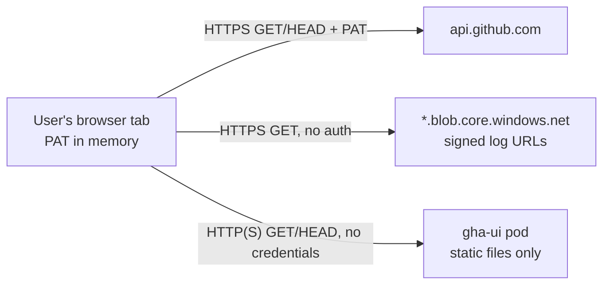
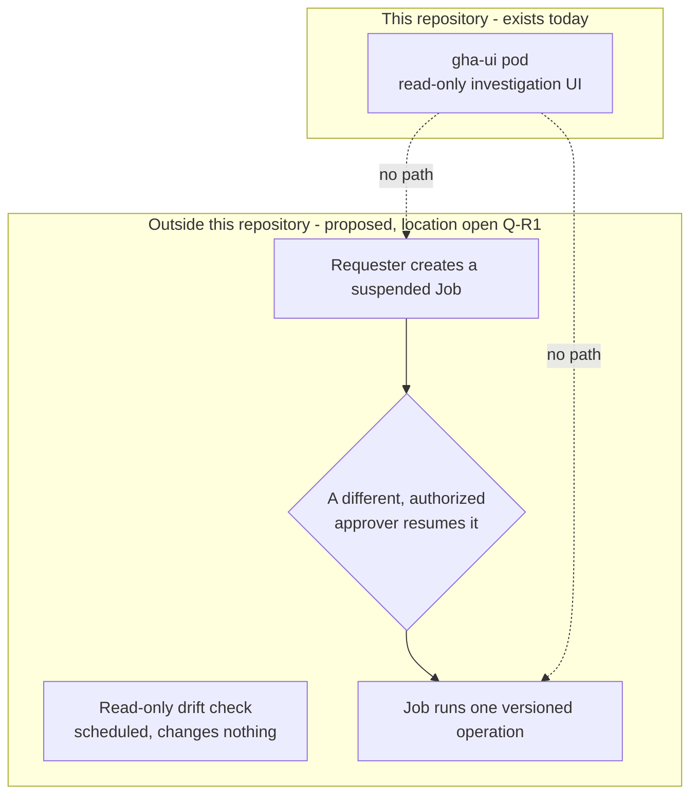

# Kubernetes access, authentication boundaries and outage recovery — proposal

**Status:** **proposal, 2026-10-29. Nothing here is approved or implemented.**
- Approved decisions are in `docs/ARCHITECTURE.md` (A1–A12).
- **Audience:** the product's primary users are maintainers of public and open-source GitHub repositories. Kubernetes, cloud accounts and organization-run tooling are **optional contexts**: some people self-host the UI or run their own infrastructure, but the product isn't designed around them.
- **§2–§3:** options for people who choose to host the UI themselves (the "possible next steps" in the roadmap's Hosting track).
- **§4:** the primary recovery direction for maintainers: a read-only **outage impact and catch-up view** to investigate first, and a possible later **"release without Actions" preparation guide**.
  - The next step is the problem-validation study in `docs/RECOVERY_VALIDATION_STUDY.md`.
- **§7–§8:** research for an **optional organization context**, where an organization wants to run recovery operations on its own infrastructure. `docs/PLATFORM_RECOVERY_DISCOVERY.md` and its brief belong to that context.
- §6 lists the decisions all of this needs.

**Evidence notation:** as in ARCHITECTURE:
- **[O]** observed or tested in this project;
- **[V]** taken from vendor or Kubernetes documentation, cited as [Src*n*] (§7.10);
- **[A]** an assumption, not yet verified here.

**Labels used here** (chosen so they don't collide with ARCHITECTURE's A-numbers or the project brief's D, E, R and S numbers):

| Label | Meaning |
|---|---|
| K-1 … K-11 | Decisions this document proposes (§6). Not the hosting milestones K1–K4 in ROADMAP |
| UA-0 … UA-4 | Options for reaching the UI (§2) |
| BA-1 … BA-5 | Options for authenticating to a future backend (§3) |
| OI-1, OI-2 | The two recovery capabilities proposed for maintainers (§4) |
| PACKAGE, RUNBOOK | The two researched recovery models for the optional organization context (§7) |
| IN-REPO, SIBLING, PLATFORM | Where recovery execution could live (§8) |
| O1–O3 | Outage scenarios (§7.2) |
| RS0–RS6 | Stages of the proposed recovery roadmap (§7.9) |
| EV1–EV7 | Evidence for the Q-R1 assessment (§8.1) |
| T, G, W, C, DR, P, DA | Question IDs in `docs/PLATFORM_RECOVERY_DISCOVERY.md` |

---

## 1. Current facts (`main` at `226a5c3`)

| Area | Fact | Source |
|---|---|---|
| App | A browser-only, read-only SPA. The tab calls `https://api.github.com` and the log host directly, with GET and HEAD only. There is no backend, database or background service | ARCHITECTURE §1, §2; `src/github/transport.ts` |
| Token | A fine-grained PAT that the user pastes. It is held in one module variable on the main thread (`src/auth/pat-provider.ts`): never in storage, the URL, React state or the worker. It is sent only to `api.github.com` | ARCHITECTURE §7.1 |
| CSP | `connect-src 'self' https://api.github.com https://*.blob.core.windows.net`; the worker has `connect-src 'none'`. The only headers source is `tools/vite/security-headers.ts` | ARCHITECTURE §7.3, §7.4 |
| Fixture mode | Compiled out of production builds. The image serves no fixture code, and fixture paths return 404 | ARCHITECTURE §11.2, §11.14 |
| Server | `deploy/ui/server.mjs`, using `node:http` only. It serves the build's files and answers `/healthz` at the root. GET and HEAD only; any other method gets 405. A 308 redirect adds the prefix's trailing slash. Unknown paths get 404. It accepts no data, proxies nothing, terminates no TLS, and ignores forwarded headers | `deploy/ui/server.mjs` |
| Paths | One image serves `/` or a prefix such as `/gha-ui/` (`GHA_UI_BASE_PATH`). The prefix must reach the server unchanged; a proxy that strips it needs the default `/` | A12; `charts/gha-ui/README.md` |
| Chart | Deployment, a ClusterIP Service (port 80 → 8080), a ServiceAccount with no token or permissions, and a `helm test` pod. No Ingress, Gateway, NetworkPolicy, RBAC or Secret | A11; `charts/gha-ui/templates/` |
| Pod | Non-root, read-only root filesystem, all capabilities dropped, seccomp `RuntimeDefault` or a valid `Localhost` profile. Weaker values are refused by the values schema | ARCHITECTURE §7.4 |
| Network | The server needs no outbound network: the image was run with networking disabled **[O]**. The chart adds **no NetworkPolicy**, so the cluster doesn't block the pod's egress | ARCHITECTURE §7.4; `charts/gha-ui/templates/` |
| Tested access | `kubectl port-forward` to the Service on Minikube 1.38 (Podman, CRI-O, amd64), at `/` and `/gha-ui/`. Headers have **not** been verified through any Gateway, Ingress, load balancer or CDN | ARCHITECTURE §11.14 and §12 ("Headers through a proxy") |
| CI | Lint, unit, build, workflow validation, Helm chart rendering and invariants, and browser tests all passed on `226a5c3` | ROADMAP, Hosting |

What does **not** exist:
- external access, TLS, and user authentication on the server side;
- server-side GitHub credentials and a backend API;
- scheduled Jobs, recovery packages or runbooks, and recovery execution;
- GitOps manifests.

---

## 2. UI access

The README's quick start runs the UI locally. This section is only for people who choose to host it on Kubernetes, which is an optional context.

### 2.1 Options for reaching the UI

| Option | What it is | Fit |
|---|---|---|
| **UA-0. `kubectl port-forward`** (current) | A per-user tunnel to the ClusterIP Service | Local checks only. HTTP on loopback; needs cluster credentials |
| **UA-1. Gateway API `HTTPRoute`** | The chart optionally renders an `HTTPRoute` that attaches to a `Gateway` the platform already runs (`parentRefs`). The chart never creates the `Gateway` | **Proposed default for shared clusters.** The Kubernetes project recommends Gateway over Ingress [Src13]. TLS, certificates and listeners stay with the platform team. Needs Gateway API CRDs and an implementation on each cluster |
| **UA-2. `Ingress`** | The chart optionally renders an `Ingress` | Widely available. The Ingress API is generally available but frozen: it will get no further changes [Src13]. Header handling depends on the controller's annotations. Reasonable only where a platform offers Ingress and not Gateway API |
| **UA-3. Service `LoadBalancer` / `NodePort`** | Already possible through values (`service.type`) | Exposes plain HTTP from the pod, because the server has no TLS. **Not acceptable** wherever a real token is typed, unless TLS terminates in front of it |
| **UA-4. Node server as reverse proxy / TLS terminator** | Extend `server.mjs` to terminate TLS or to proxy `/api` to a backend | **Not recommended.** It mixes certificate handling and proxy code into the process that serves the token page, ends A10's "files only" property, and duplicates what a Gateway does. The current server's small attack surface is a deliberate property |

### 2.2 Root and prefix hosting through a route

- **Root:** route `PathPrefix /` to the Service, and keep `basePath` empty.
- **Prefix:** route `PathPrefix /gha-ui/` **without** a `URLRewrite` filter, and set `basePath=/gha-ui/`. The server needs the prefix intact (A12).
- **If the platform strips the prefix,** leave `basePath` empty instead. Never combine stripping with `basePath`.
- **`/healthz`** answers at the root by design. It is used by probes inside the cluster and need not be routed externally.
- A route for `/gha-ui` (no trailing slash) reaches the server's 308 redirect, which keeps the query. Whether it does depends on how the route matches the path **[A]**.

### 2.3 TLS and security headers

- **TLS terminates at the Gateway listener,** with certificates from the platform: cert-manager or the cloud provider's managed certificates. Gateway → pod traffic stays HTTP inside the cluster, as now. Mesh mTLS is a platform choice, not a chart one.
- **HSTS** belongs at the TLS terminator, because the server never sees HTTPS. This is a decision: Gateway `ResponseHeaderModifier` or platform policy (§6, K-2). Support for that filter depends on the Gateway implementation **[A]**.
- **The CSP and other headers must pass through unchanged.** A Gateway, CDN or WAF that adds a second CSP, removes one, or rewrites it changes the page's protection. Before any external access is relied on:
  - run `deploy/ui/check-http.ts <external-base-url>` through the real path, both root and prefix;
  - run the browser spec (`tests/e2e/static-server.spec.ts`) against it.

  These already exist and compare against the single headers source.
- **Caching:** the server sends `no-cache` on the page and immutable caching on hashed assets. A CDN must respect these, or token-entry pages may be cached incorrectly **[A]**.

### 2.4 Portability: Minikube, kind, AKS, EKS, GKE

The chart stays cluster-neutral: Deployment and Service by default, with an optional `HTTPRoute` off by default. Cluster-specific pieces stay outside the chart.

| Cluster | Gateway API source (to verify per cluster) |
|---|---|
| Minikube, kind | Install the Gateway API CRDs and one implementation, at pinned versions (for example Envoy Gateway, NGINX Gateway Fabric, Istio or Cilium). Use a self-signed or local CA certificate **[A]** |
| AKS | The managed option (Application Gateway for Containers) or an in-cluster implementation **[A]** |
| EKS | The AWS Load Balancer Controller's Gateway API support or an in-cluster implementation **[A]** |
| GKE | The built-in GKE Gateway controller **[A]** |

**Proposed acceptance for "external access works on cluster X":**
- `check-http.ts` and the browser spec pass through the external URL at both paths;
- `helm test` passes;
- a TLS certificate is valid for the host.

So far only Minikube has been tested, and only through port-forward **[O]**.

---

## 3. Authentication boundaries

### 3.1 Current boundary (fact)

- The UI pod is outside the token's path: it never receives the PAT, cookies or any user data. Compromising it would still matter, because it serves the code that handles the token (ARCHITECTURE §7.4, residual risks).
- GitHub enforces every permission. The app holds no credential of its own.

### 3.2 Why a ClusterIP backend is not reachable from an ordinary browser

A ClusterIP Service "is only reachable from within the cluster", and can be exposed through an Ingress or a Gateway [Src14]. A user's browser normally runs outside the cluster. A backend behind ClusterIP becomes reachable from it only through something that exposes it:
- a route (Gateway or Ingress);
- a `LoadBalancer` or `NodePort` Service [Src14];
- an operator tunnel such as `kubectl port-forward` or the API server's proxy, which needs cluster credentials;
- a network where the platform makes service addresses routable from outside, which is platform-specific **[A]**.

Any backend used from ordinary browsers therefore needs:
- **an exposure path**, which brings a public or internal hostname, TLS, and an authentication requirement;
- **a CSP change or same-origin placement.** Today `connect-src` allows `'self'`, `api.github.com` and the log host only. Serving the API under the UI's origin (for example `/gha-ui/api/` through the same Gateway) keeps `'self'` sufficient. A different origin would need the CSP widened and CORS configured.

Adding an endpoint that accepts data also ends A10's "the server accepts nothing" property for that origin. Same-origin placement means the API and the token page share an origin, so an XSS in either affects both.

### 3.3 Options for authenticating to a future backend

| Option | How | Assessment |
|---|---|---|
| **BA-1. Network only** (VPN, private cluster) | No user identity | Not sufficient for anything that reads private data or acts. Identity is needed for authorization and audit |
| **BA-2. Forward the user's PAT to the backend** | The browser sends the PAT to the backend, which calls GitHub | **Reject.** It moves the token server-side (D3/U1), widens exposure (logs, memory, proxies), and makes the backend a token collector |
| **BA-3. Identity at the Gateway** (OIDC through the Gateway implementation's external auth, or an auth proxy) | The organization's IdP authenticates users. The Gateway passes a verified identity to the backend | Central and consistent for UI and API. The backend must accept identity **only** from the Gateway: strip client-supplied identity headers, and add a NetworkPolicy so only the Gateway reaches the backend |
| **BA-4. Backend-native OIDC** (SPA with PKCE, or a backend session cookie) | The backend validates IdP tokens itself | Stronger end-to-end validation, at the cost of more code. Cookies need `Secure`, `HttpOnly`, `SameSite=Strict` and CSRF protection. Tokens in memory need the same handling as the PAT |
| **BA-5. GitHub OAuth / GitHub App user tokens** | GitHub as the identity provider | Reuses GitHub permissions, but is "OAuth login" (U2, not on the roadmap) and puts GitHub credentials server-side. It also stops working during a GitHub outage (§7.2) |

**Proposal, if a backend is ever approved (K-3):**
- user identity from the organization's IdP, through BA-3 or BA-4, with authorization by explicit group membership;
- the browser's PAT path stays as it is, separate from the backend;
- the backend gets **no** GitHub credential until a specific feature needs one. Any credential it does get is a separate decision (K-5), for example a GitHub App installation token with the minimum repository permissions.

### 3.4 Least privilege and trust boundaries (proposed)

- **One trust zone per component:**
  - the UI pod, plus a backend if one is ever approved;
  - and, outside this repository (§8.4), a read-only drift check and a recovery executor.

  Each has its own ServiceAccount, with automounted tokens off unless it calls the Kubernetes API.
- **Separate namespaces:** recovery execution runs in its own namespace, with Pod Security "restricted" and no route from the UI's namespace. It is owned by whoever owns the executor (§8).
- **NetworkPolicy:**
  - the UI pod needs no egress, but the chart doesn't yet restrict it (§1);
  - a backend reaches only what it calls;
  - execution Jobs reach only their declared targets.

  NetworkPolicy is enforced only if the cluster's network plugin supports it **[A]**.
- **No shared Secrets** between components. Secrets come from the platform's secret store at run time and are never baked into images or bundles.

---

## 4. Recovery for repository maintainers: primary direction (2026-10-29)

**Status:** a direction to **investigate**, not a design.
- Nothing here is approved, implemented or validated. No user research has been done.
- The next step is the problem-validation study in `docs/RECOVERY_VALIDATION_STUDY.md`.
- **Notation:** [O] verified in this repository, [V] from documentation, [A] an assumption to validate, [Q] an open question.

**Boundaries that don't change:**
- The UI stays **read-only**. It executes no workflows or recovery operations.
- It gains no write or privileged credentials, and stores or shows no secret values.
- It adds no caching, persistence, backend, scheduled job or executor.

### 4.1 Problems maintainers may face when Actions or related services are unavailable

All of these are **[A]**, to be tested by the study:
- **Is it GitHub or my project?** Runs queued for a long time, cancelled, or failing with runner errors look like the project's own failures.
- **Releases and publishing blocked:** packages, container images, GitHub Releases, documentation sites.
- **Merges blocked:** required checks never report, so PRs wait.
- **Missed scheduled work:** nightly builds, dependency updates and housekeeping jobs that didn't run.
- **Catch-up after recovery:** which runs to re-run, and which releases are half done (for example a tag without published packages).
- **Credentials that work only inside Actions:** publishing or deploying through GitHub's OIDC has no automatic fallback outside Actions [Src3]. How each registry handles this is study item D-3.
- **Self-hosted runner problems** in the maintainer's own setup look similar to a GitHub outage.

### 4.2 What the UI can help with, and what it can't

| The UI can help, read-only, whenever GitHub's API is reachable | Needs something outside GitHub Actions, run by the maintainer |
|---|---|
| Showing failed, cancelled or never-started runs in a time window, with whatever evidence the API gives, and `unknown` otherwise | Actually building, publishing or deploying while Actions is down |
| Showing **possible** missed scheduled runs (schedule versus actual runs) | The credentials for that, which stay with the maintainer and never reach the UI |
| Listing PRs waiting on checks, where the data is readable (see the permission note in §4.3) | Running workflow steps elsewhere: locally, with an emulator for the parts it supports, or on another CI service, with the limits in §7.3 |
| Linking to GitHub so the person re-runs there | — |
| Reconciling, after recovery, what happened against the run, release, deployment and artifact evidence the app already reads | — |

**During a GitHub-wide outage the UI can show nothing [O].** It reads only GitHub's API and keeps nothing between sessions (A4). Help *during* such an outage has to be prepared in advance and live outside the UI.

### 4.3 First capability to investigate: OI-1, outage impact and catch-up view

A read-only view for one repository and a time window. It would show:
- **Failed and cancelled runs,** and runs that never started or started very late, with the evidence the API provides. Each is classified as supported by evidence, or **`unknown`**, never with a stated cause (the product rule, ARCHITECTURE §1).
- **Possible missed scheduled runs:** the workflow's `cron` at the default branch, compared with its `schedule` runs. A missing run is **not** proof of an outage. GitHub documents that scheduled runs can be delayed or dropped under high load, and that scheduled workflows in public repositories are disabled after 60 days without activity. So these are always labelled "possible", cause unknown (study §2, [V]).
- **PRs waiting on checks.** The app doesn't read pull-request or check data today, and requests only Actions, Contents and Metadata read access **[O]**. This part is limited to what those permissions can read. It may be available for public repositories **[A]**, and is otherwise deferred to open question Q2 (ARCHITECTURE §7.1).
- **Links to GitHub** for each run or job to re-run. The view itself changes nothing.

**Why first:**
- it applies to any repository, public or private;
- it needs no Kubernetes, cloud account or new privileged permission;
- it fits the read-only model and the "evidence, not causes" rule;
- it extends features that already exist: run history, failure evidence, the `schedule` event filter, the workflow source view and the `unknown` status [O].

Whether maintainers need it is **[A]**.

### 4.4 Possible later capability: OI-2, a "release without Actions" preparation guide

A read-only, clearly caveated export, possibly through the existing report export. It would describe:
- a release workflow's steps at a commit, and the tool versions it pins;
- the secrets it uses, **by name only**;
- what cannot be reproduced outside GitHub (§7.3).

**The maintainer prepares and runs everything with their own tools and credentials. The UI executes nothing.** Its main risk is looking more authoritative than it is, so it would be investigated only if the study shows the need.

### 4.5 Constraints for public repositories and self-hosted setups

- **Public repositories:** workflows and logs are public, but secret values never are. Exports contain secret names only, and must not suggest putting credentials in files or workflows. PRs from forks don't receive secrets.
- **No infrastructure assumed:** many maintainers have only a laptop and a browser. Nothing in §4 needs Kubernetes, a cloud account or organization tooling.
- **Permissions:** OI-1 stays within the existing read-only token set. Anything needing more (PR, check or administration data) waits for Q2.
- **External pages:** showing GitHub's status page inside the UI would need a CSP change, which would be its own decision. Linking to it doesn't.
- **Self-hosted runners:** their status may need permissions beyond the current set **[Q]**. Outages of the maintainer's own runners are a separate cause the view must not mislabel.

### 4.6 Optional organization context (see §7–§8)

The rest of §4 applies **only** where an organization chooses to run recovery operations on its own infrastructure, for example with Kubernetes. That context is optional and doesn't shape the product.
- §7 compares two models for it: **PACKAGE** and **RUNBOOK**. The research recommendation for that context is RUNBOOK, plus a read-only drift check (§7.6). Neither is chosen (K-6).
- The investigation UI has no part in it under any option.

#### Separation

- **The read-only UI never requests, approves, starts or executes a recovery operation.** It has no credential or route to do so, and its chart stays unchanged.
- **The drift check and the executor would live outside this repository** (§8.3, recommended, not decided).

#### Which constraints change, under which boundary option

| Boundary option (§8) | This project's constraints (ARCHITECTURE §2: D3 "no backend", D4 "read-only") | Recovery executor's constraints |
|---|---|---|
| **IN-REPO** | Would change. D3 and D4 would have to be revised, along with the README's public promises (§8.6) | Part of this project |
| **SIBLING** | Unchanged. This repository stays read-only with no backend | Its own repository and owners set them. It changes deployment targets, so it is not read-only |
| **PLATFORM** | Unchanged | Set by the platform team's tooling |

#### Execution controls (proposed, untested)

These apply to whichever location runs organization recovery. None has been implemented or tested here.

- **Permission to create, approval, and execution are three separate things.**
  - **Create:** a requester may create a Job in the execution namespace only in the **suspended** state.
  - **Approve:** a *different*, authorized person approves it.
  - **Execute:** the Job runs only when the approval resumes it.

  RBAC can limit who may create or update Jobs. It **cannot** by itself ensure that the approver is not the requester, so group membership alone is not two-person approval. §7.5 proposes an admission policy for that, with its known gaps and the negative tests it needs. Until those tests pass, the mechanism must not be treated as enforcing anything.
- **Identity:** a ServiceAccount used only for this purpose, holding only the permissions the target needs. Cloud credentials are short-lived (workload identity, [Src6]–[Src8]), never long-lived keys in a bundle.
- **Job settings:**
  - `backoffLimit: 0`, so a failed pod is not retried. This doesn't prevent a second start: Kubernetes documents that the program "may sometimes be started twice" even then [Src10], so every operation must be safe to re-run;
  - `activeDeadlineSeconds` and `ttlSecondsAfterFinished`;
  - the restricted Pod Security profile, and a read-only root filesystem where the task allows;
  - egress limited to the declared targets.
- **Audit:** who requested, who approved, the operation version, start and end, and the logs. These are kept outside the cluster that runs the Job.
- **Re-entry:** once GitHub is back, the change is reconciled into the normal workflow and repository history. That reconciliation is a manual step, not automated.

---

## 5. Trade-offs and proposed defaults

| Topic | Proposed default | Main alternative | Why |
|---|---|---|---|
| External access | Optional `HTTPRoute`, off by default, attached to a platform-owned `Gateway` | Optional `Ingress` | Recommended by the Kubernetes project over the frozen Ingress API [Src13]; keeps TLS and listeners with the platform; the chart stays portable |
| TLS | At the Gateway; HSTS added there | TLS in the pod | The pod stays files-only, and certificate handling stays with the platform |
| Header integrity | Verified with `check-http.ts` and the browser spec through every real access path | Trust proxy configuration | Proxies are the open risk recorded in ARCHITECTURE §12 |
| Backend | **None yet.** First decide which feature needs one, then model its threats | Build an API "for later" | A backend adds an exposed, data-accepting endpoint on the token page's origin |
| Backend identity | Organization IdP (OIDC) at the Gateway or the backend | GitHub OAuth (U2) | Works when GitHub is down, and keeps GitHub credentials out of the server |
| GitHub credentials server-side | None until a feature requires one, then a GitHub App with minimal permissions | Forwarding the user's PAT | PAT forwarding is rejected (§3.3, BA-2) |
| Recovery help for maintainers (primary) | Investigate OI-1, the read-only outage impact and catch-up view, through the validation study (§4.3) | Build nothing until the study reports | Broadly applicable; no new privileged permission; fits the read-only model. Need not yet validated |
| Recovery model (optional organization context) | RUNBOOK, plus a read-only drift check (the current research recommendation, §7.6) | PACKAGE | Designed least privilege; small review surface; the PACKAGE model reproduces only the portable part of a workflow (§7.3) |
| Recovery execution (optional organization context) | An isolated Job created suspended, resumed only by a different authorized approver. Enforcement is proposed and untested (§4.6, §7.5). No UI trigger | An "execute" button in the UI | Keeps the read-only UI read-only, with no privileged path through the page that holds a token |
| GitOps (Argo CD, Flux) | Examples only, after access is decided | Required deployment path | If the Git source is on GitHub, GitOps is unavailable during a GitHub outage, so it cannot be the recovery path |

---

## 6. Decisions that need approval

None of these is approved.
- **Decisions about this repository** (K-1 to K-5, K-8, K-9) belong to the project maintainer. Each is recorded as a new A-number in ARCHITECTURE when made.
- **Decisions about recovery help in the UI** (K-10, K-11) also belong to the project maintainer, after the validation study.
- **Decisions about running recovery operations** (K-6, K-7) apply only to the optional organization context, and depend on Q-R1. Who has authority over them is an open question for that organization (checklist DA2), as is where they are recorded (DA4).

| ID | Decision | Proposed default | Blocks |
|---|---|---|---|
| **K-1** | External access mechanism, and whether the chart gains an optional `HTTPRoute` (and/or `Ingress`) template | Optional `HTTPRoute`, off by default | Any non-local use |
| **K-2** | Where TLS terminates, and who adds HSTS | Gateway listener; HSTS at the Gateway | K-1 |
| **K-3** | Whether a backend exists at all (revises D3), for which feature, and with which threat model | Not yet | K-4, K-5 |
| **K-4** | How users authenticate to a backend | Organization IdP via OIDC (BA-3 or BA-4) | K-3 |
| **K-5** | Whether any GitHub credential is held server-side, and in what form | None; if needed, a GitHub App with minimal permissions | K-3 |
| **K-6** | *(Optional organization context)* Recovery model (PACKAGE or RUNBOOK), its bundle format, store and signing key | Researched in §7: RUNBOOK first, with a read-only drift check. Not chosen | K-7 |
| **K-7** | *(Optional organization context)* Recovery execution controls: approval, where it runs, which targets. It changes this project's D4 only under IN-REPO (§4.6) | A suspended Job resumed by a different authorized approver, enforced by a mechanism shown to work by negative tests (§7.5). No UI trigger | — |
| **K-8** | GitOps examples (Argo CD, Flux) | After K-1; examples only | — |
| **K-10** | Whether to build OI-1, the read-only outage impact and catch-up view, and with which signals | Decide after the validation study (`docs/RECOVERY_VALIDATION_STUDY.md` §6). Existing read-only permissions only; PR and check data wait for Q2 | — |
| **K-11** | Whether to investigate OI-2, the "release without Actions" preparation guide | Only if the study shows the need; read-only export, secret names only, the UI executes nothing | K-10 |
| **K-9** | Published images: registry, digests, signing, SBOM | Needed before K-1 is used outside local development | K-1 in production |

**Approved today, and unchanged by this document:** A10–A12 (the static image, the chart, root and prefix hosting). The app stays browser-only and read-only, with the PAT in tab memory.

---

## 7. Optional organization context — research: outage-recovery execution models (2026-10-29)

**Scope:** this section applies only where an organization wants to **run** recovery operations on its own infrastructure. That is an optional context, not the product's default audience; maintainers' needs are covered in §4. The investigation UI executes nothing in either case.

**Status:** research and analysis only. Nothing in this section is approved, and no part of it is implemented. It compares two recovery models for decision K-6:
- **PACKAGE:** a recovery package derived from a workflow.
- **RUNBOOK:** a maintained break-glass runbook.

### 7.1 Evidence base

- **Repository facts [O]:**
  - This repository holds a read-only UI, its image and its chart. It has no Job, CronJob, execution, packaging or signing code, and no workflow it would recover.
  - Which workflows, environments and clouds would need recovery is **not known**. That is the first open question (§7.8).
- **External sources [V]** are cited as [Src1]–[Src15] and listed in §7.10. They were read on 2026-10-29.
- **Assumptions [A]** are marked where they are used. None of the mechanisms below has been tested in this project.
- **Scope note:** the README describes the project as "an open-source viewer and dashboard for GitHub Actions workflow runs, pipelines and logs" that "never changes anything". ARCHITECTURE §2 makes read-only (D4) and no backend (D3) constraints. Executing recovery operations is therefore outside the project's published scope. Where it would live is decision Q-R1 (§8).

### 7.2 Outage scenarios

GitHub reports Git operations, API requests, Actions, Packages and Webhooks as separate components [Src1], so outages can be partial:

| Scenario | Available | Unavailable | Consequence |
|---|---|---|---|
| **O1. Actions execution only** | Git, API, Packages | Workflow runs. Self-hosted runners also stop receiving jobs, because they connect to GitHub for job assignments [Src2] | The source, workflow files and `ghcr.io` images can still be read; only the execution engine is missing |
| **O2. GitHub-wide** (Git, API and Actions) | Nothing on github.com | Source, workflow files, Actions, OIDC tokens from `token.actions.githubusercontent.com` [Src3], and `ghcr.io` | Everything a recovery needs must already be outside GitHub |
| **O3. Packages only** | Git, API, Actions | `ghcr.io`, GitHub package registries | Normal workflows fail if they pull from GitHub-hosted registries |

A credible design must be **assessed** against **O2**, the worst case; O1 is only easier. Which scenarios a given operation must survive is decided per operation (`docs/PLATFORM_RECOVERY_DISCOVERY.md` §8–§9).

### 7.3 PACKAGE: a recovery package derived from a workflow

**Process (proposed):** while GitHub is healthy, a scheduled preparation Job does the following:
1. reads one approved workflow at one commit SHA;
2. resolves everything it references;
3. classifies each step;
4. vendors and pins the dependencies;
5. writes a signed package to a store outside GitHub.

**Inventory it must produce:**

| Item | What must be captured | Source of difficulty |
|---|---|---|
| Reusable workflows (`uses: ./…` or `owner/repo/…@ref`) | Each called workflow at a commit SHA, transitively, with its `with:` and `secrets:` mapping | Nesting; `secrets: inherit`; refs given as tags or branches |
| Actions | JavaScript, Docker and composite actions at full commit SHAs, vendored with their `node_modules` or image digest | Tags move; composite actions nest further actions; Docker actions may build at run time |
| Scripts | Repository files the steps run, at the same commit | Scripts that download more code at run time |
| Images | Job, service and Docker-action images, by digest, mirrored outside `ghcr.io` | `ghcr.io` is unavailable in O2 and O3 |
| Dependencies | Package-manager lockfiles, plus a vendored copy or a mirror | Package registries are separate services; whether they are reachable in an outage is unknown **[A]** |
| Secrets | Names and the scope each comes from (repository, environment, organization). **No values** | Values must come from a secret store outside GitHub at execution time |
| Permissions | The `permissions:` block (what `GITHUB_TOKEN` would have), and cloud roles reached via OIDC | `GITHUB_TOKEN` and GitHub's OIDC tokens are issued by GitHub for Actions jobs [Src3] |
| External services | Every host the steps contact | Usually found only by reading the scripts, or by observing a run |
| Target and manifest | The named environment and account; SHA-256 of every file, source commit, creation time, preparer identity, expiry | Must match what the approver approves |

**Compatibility classes:** each step is classified as one of:
- **portable:** a plain `run:` script with pinned tools and no GitHub context;
- **translatable:** a known action replaced by a reviewed equivalent, for example a cloud login done with workload identity;
- **not reproducible:** the package is refused, and that step is listed.

**What a package cannot claim.** Behaviour outside GitHub-hosted runners falls into three groups, and **a package must never claim equivalence**:
- **Provided by GitHub itself, so unavailable outside it:**
  - runner job assignment [Src2];
  - `GITHUB_TOKEN` and the `permissions:` it carries;
  - OIDC tokens from GitHub's issuer [Src3];
  - environment protection rules and reviewers.
- **Listed as unsupported by `act`,** a tool built to emulate Actions locally [Src4]:
  - `concurrency`, `job.permissions`, `timeout-minutes` and `continue-on-error`;
  - `job.environment` and environment-scoped secrets;
  - the OIDC URL, and a complete `github` context.
- **Not validated here:**
  - expressions, `needs` outputs, matrix expansion, caches, artifacts, and job and service containers;
  - emulators implement parts of these, but equivalence with GitHub's behaviour is neither guaranteed nor tested in this project.

**Arbitrary workflows cannot be assumed to run unchanged outside GitHub.** PACKAGE can only cover the portable subset, after review.

**Verification at execution time (proposed):**
- **Integrity:** the SHA-256 of every file matches the manifest, and the manifest signature verifies with a key held outside GitHub (for example cosign with a KMS key [Src5]). Whether verification works fully offline depends on the signing setup **[A]**.
- **Provenance:** the manifest records the source repository, commit, workflow path, preparation Job identity and time. The signing identity is the preparation Job's, not a person's.
- **Freshness:** the package is refused if it is older than its expiry, or if the target environment's recorded release no longer matches the one it was prepared against (the drift check, §7.6).
- **Completeness:** there are no unresolved `uses:` references, every image has a digest and a mirror copy, every secret name maps to the secret store, and every step is portable or translatable.

### 7.4 RUNBOOK: a maintained break-glass runbook

**Definition:** a small, named set of recovery operations, for example "redeploy release R of service S to environment E" and "roll back E to its previous release". Each is written as a script or Kubernetes Job template that **does not depend on the GitHub Actions engine**, and is maintained and tested as a product in its own right.

| Property | Proposal |
|---|---|
| Ownership | One named owning team per operation, recorded with the operation. Unowned operations are disabled |
| Review | Changes need review by someone other than the author. Operations live in a repository mirrored outside GitHub, so they stay readable in O2 **[A]** |
| Testing | A drill in a relevant non-production environment for every operation, plus a dry-run mode that prints the intended changes. The drill result is recorded (checklist DR1) |
| Versioning | Each operation is released as an immutable, signed bundle: an image by digest plus a manifest. Executions reference a digest, never "latest" |
| Approval | Two-person: the requester and the approver are different people, enforced by the system (§7.5, checklist C1) |
| Expiry | An operation with no passing drill within its window (for example 90 days **[A]**) is disabled until it passes again. The window is open question Q-R5 |

**In each scenario:**
- **O1 (only Actions down):** source and metadata can still be read from GitHub, for example to confirm which release is current. That is a convenience; the operation must not need it.
- **O2 (GitHub-wide):** the operation runs from its signed bundle in a registry outside GitHub. Credentials come from cloud workload identity or the secret store, and its inputs come from the approved request. Anything an operation reads from GitHub must be optional or available from a mirror.

### 7.5 Security and operational comparison

| Criterion | PACKAGE | RUNBOOK |
|---|---|---|
| Credentials and least privilege | Must reproduce every permission the workflow had, often broad, without `GITHUB_TOKEN` or GitHub OIDC [Src3]. The privilege set is inherited from the workflow, not designed | Each operation gets its own ServiceAccount and cloud role, scoped to what it does. Short-lived cloud credentials via AKS Workload ID [Src6], EKS Pod Identity [Src7] or GKE Workload Identity Federation [Src8] |
| Two-person approval and audit | The same mechanism (below). Approvers also need a reviewable view of a large generated package | The same mechanism. Approvers review a small, known operation and its inputs |
| Isolation from the UI and backend | Both run in a separate namespace with its own ServiceAccount and NetworkPolicy, and with no route or credential from the UI (§4.6) | The same |
| Secret delivery | Many secrets, mapped from GitHub scopes to a secret store. Kubernetes Secrets are unencrypted in etcd by default; the mitigations are encryption at rest, least-privilege RBAC, and external stores via the Secrets Store CSI driver [Src9] | The same mechanisms, with far fewer secrets |
| Network dependencies | Every host the workflow contacts, plus mirrors for actions, images and packages | Only the operation's declared targets, its registry and its identity provider |
| Partial failure and rollback | The workflow's own error handling (`if: failure()`, `needs`) is only partly reproducible, so behaviour after a partial failure is uncertain | Each operation defines its failure states and has a paired rollback operation, both drilled |
| Idempotency and duplicates | A Job can start a program twice even with `parallelism=1`, `completions=1` and `restartPolicy: Never` [Src10]. Workflow steps are rarely written for that | Operations are written to converge to a declared state, so a re-run is safe. A deterministic Job name per approval prevents duplicate creation; a lock (for example a `Lease`) prevents concurrent runs on one target **[A]** |
| GitHub repositories or API also down (O2) | Works only if the package was prepared, mirrored and kept fresh **before** the outage | Works if the bundle, images and identity are outside GitHub. It needs nothing from GitHub at run time |
| Portability | Depends on what the workflow calls. Cloud identity differs per provider | The Job template is portable; only the identity binding differs per cloud. Minikube and kind have no cloud workload identity and are for tests only **[A]** |
| Maintenance burden | High: re-resolving actions and their transitive references, translating steps, updating mirrors, and following every change to the workflow | Proportional to the number of operations. It stays low only if the set stays small (1–3) |
| Realistic recovery objectives | Restore time includes reviewing an unfamiliar package at incident time; data is current as of the last preparation | Restore time is approval plus a drilled operation. **Measure it in drills; no target is claimed here** |

**Two-person approval mechanism: proposed, untested [A]. The same for both models.**

It separates three permissions. None of this has been implemented or tested, and it must not be described as enforcing anything until the negative tests below pass on a real cluster.

1. **RBAC (necessary, not sufficient):**
   - requesters may create Jobs in the execution namespace;
   - approvers may update Jobs there;
   - no other identity may do either.

   RBAC alone can't tell a requester from an approver on the same Job.
2. **Admission, using a ValidatingAdmissionPolicy.** These are stable since Kubernetes 1.30, and their CEL rules can read `object`, `oldObject` and `request` (including `request.userInfo`) [Src11].
   - **On CREATE of a Job:**
     - require `spec.suspend: true`;
     - require a `requested-by` annotation equal to `request.userInfo.username`;
     - require that the Job references an approved operation version. *How that reference is checked (for example an allow-list of bundle digests as policy parameters) is not designed yet.*
   - **On the UPDATE that changes `spec.suspend` from true to false:**
     - require that the user differs from `requested-by`;
     - require that the user belongs to the approver group.
   - **On any other UPDATE of a suspended Job:**
     - refuse changes to its spec, because some scheduling fields stay mutable while it is suspended [Src10];
     - refuse changes to the `requested-by` annotation.
   - The policy must fail closed if it can't be evaluated **[A]**.
3. **Audit:** Kubernetes audit logging records the requests that create and resume the Job [Src12]. Managed clusters expose audit logs through the provider.

**Known gaps:**
- **Impersonation.** An impersonated request is authorized as the impersonated user, and admission sees that user's information [Src15]. Anyone allowed to impersonate a requester or an approver can defeat the separation. Whether the audit log records the original user as well was not confirmed here **[A]**. Impersonation rights over these identities must be excluded, or treated as a bypass under checklist C7.
- **Deletion and recreation.** An approval applies to one Job object, so a recreated Job needs a new approval. Who may delete Jobs in the namespace, and whether deleting a running Job is a recovery risk in itself, is **not designed yet**.
- **CronJobs.** Jobs created by the CronJob controller carry the controller's identity, not a person's, so the `requested-by` rule can't attribute them **[A]**. Creating CronJobs in the execution namespace should be refused, by RBAC or admission (proposed). `kubectl create job --from=cronjob/…` creates the Job as the calling user, so the CREATE rules above apply to it.
- **Administrators.** Cluster administrators can change or remove admission policies. Audit review can at most **detect** such a bypass. Accepting detection instead of prevention is a recorded residual-risk decision by someone with that authority, not a property of the mechanism (checklist C7).

**Negative tests the mechanism must pass** (stage RS2, §7.9). Each must be refused, or for the last two, detected:
- creating a Job without `spec.suspend: true`;
- creating one with a missing or mismatched `requested-by`;
- the requester resuming their own Job;
- a non-approver resuming a Job;
- changing the spec or `requested-by` while suspended;
- creating a CronJob in the namespace;
- recreating a Job after deletion without a new approval;
- an approval through impersonation by the requester;
- an administrator bypass, if detection is the chosen control.

### 7.6 Research recommendation (not approved)

**RUNBOOK first, with a read-only drift check borrowed from PACKAGE.**

- **Why:**
  - O2 is the scenario to assess against, and in O2 neither model can reach GitHub.
  - RUNBOOK's credentials are designed per operation instead of inherited.
  - Its review surface is small, and its behaviour is shown by drills.
  - For most real workflows, PACKAGE's honest output would be "not reproducible" for key steps (§7.3), so it adds the most complexity for the least assurance.
- **What survives from PACKAGE:** a scheduled, **read-only** check, run while GitHub is healthy.
  - It compares each runbook operation's pinned references (images, release identifiers, target names) with what the corresponding workflow currently deploys.
  - It reports drift and changes nothing.
  - It runs on a schedule with a read-only GitHub credential, so it lives with the executor's owner, **not in this repository** (§8.4).

**Proposed first implementation scope**, if approved later by whoever holds that authority (§6):
- **one** operation, proposed and agreed under Q-R2 (checklist §11), for example "redeploy a pinned release to one environment";
- a dry-run mode;
- a suspended-Job template with the two-person admission policy (§7.5);
- one namespace, one ServiceAccount and one NetworkPolicy;
- a drill, on Minikube or kind first, against a disposable target.

### 7.7 Non-goals

- Running arbitrary or unmodified GitHub Actions workflows outside GitHub.
- An "execute", "request" or "approve" control in the read-only UI, or any change to the UI's chart, image or token handling.
- Emulating `GITHUB_TOKEN`, GitHub OIDC, environments or `concurrency`.
- Storing secret values in packages, bundles, images, Git or the UI.
- Automatic triggering on outage detection. Every execution needs a person to request it and a different person to approve it.
- Multi-step orchestration or a workflow engine.

### 7.8 Open questions and decision criteria

**Open questions:**
- **Q-R1:** where would recovery execution live: this repository, a sibling repository, or a platform team's tooling? The README and ARCHITECTURE scope this project to viewing and investigating runs, read-only (§7.1). Assessed in §8; still open.
- **Q-R2:** which operations, services, environments and clouds actually need recovery, and who owns them? A proposed split of responsibilities is in `docs/PLATFORM_RECOVERY_DISCOVERY.md` §11: proposing, confirming need, target and credential ownership, authorization, risk acceptance. It is not approved.
- **Q-R3:** where do source mirrors, bundles and images live outside GitHub? Which signing keys or KMS hold the signatures?
- **Q-R4:** who are the approvers, how are they grouped in the identity provider, and what is the escalation path when only one person is available?
- **Q-R5:** what drill frequency and expiry window apply, and what recovery-time target will drills be measured against?
- **Q-R6:** is a package registry outage (npm, PyPI, container registries) in scope?

**Decision criteria for K-6 and K-7:**
- works in the outage scenarios agreed for each operation, assessed against O2;
- least privilege per operation;
- the two-person rule is enforced by the system, shown by the negative tests in §7.5, not only by procedure;
- a re-run is safe;
- a passing drill (checklist DR1) in a relevant non-production environment on each cloud the operation targets;
- an owner for every operation;
- maintenance effort the owning team accepts.

### 7.9 Staged roadmap (proposed; each stage needs approval)

These stages would be carried out wherever recovery execution lives (Q-R1), not necessarily in this repository.

| Stage | Scope | Test gate | Security gate |
|---|---|---|---|
| **RS0. Decide** | Answer Q-R1–Q-R6, and choose K-6 and K-7. No code | Q-R1 recorded where checklist DA4 says; K-6 and K-7 recorded by the owner of the chosen location | Threat model for the execution namespace reviewed |
| **RS1. One operation, dry run** | The bundle format and one operation in dry-run mode, on kind or Minikube | The dry run prints the exact intended change; re-running it gives the same output | Nothing executes; the image is non-root and read-only; there are no secrets |
| **RS2. Approval gate** | Suspended-Job template and the admission policy | Every negative test in §7.5 is refused, or detected where detection is the chosen control | Audit events show requester and approver; no namespace gets broader RBAC |
| **RS3. Real execution, local target** | The operation runs against a disposable target on kind or Minikube | Running it twice converges; the paired rollback restores the previous state; a forced partial failure is reported | Only declared egress; any test credentials are short-lived |
| **RS4. One cloud, non-production** | Workload identity on the chosen provider [Src6]–[Src8], with secrets from the provider's store | A drill in a relevant non-production environment, with the restore time measured | Cloud role limited to the operation; Secret encryption at rest or an external store [Src9] |
| **RS5. Drift check** | The read-only comparison from §7.6 | It reports synthetic drift and stays quiet when nothing has drifted | Read-only GitHub access; no write tokens |
| **RS6. O2 drill** | A non-production drill with github.com unreachable from the execution namespace | The operation completes without contacting GitHub | Bundle signature and digests verified before the run |

### 7.10 Sources (read 2026-10-29)

- [Src1] GitHub Status, components list — https://www.githubstatus.com/
- [Src2] GitHub Docs, Self-hosted runners reference: runners "connect to GitHub to receive job assignments"; the required endpoints include `github.com`, `api.github.com` and `*.actions.githubusercontent.com` — https://docs.github.com/en/actions/reference/runners/self-hosted-runners
- [Src3] GitHub Docs, OpenID Connect: tokens issued by `https://token.actions.githubusercontent.com` — https://docs.github.com/en/actions/concepts/security/openid-connect
- [Src4] act, features not supported — https://nektosact.com/not_supported.html
- [Src5] Sigstore, signing blobs (key pairs and KMS keys) — https://docs.sigstore.dev/cosign/signing/signing_with_blobs/
- [Src6] Microsoft Learn, Microsoft Entra Workload ID on AKS — https://learn.microsoft.com/en-us/azure/aks/workload-identity-overview
- [Src7] AWS, EKS Pod Identity (not available for pods on AWS Fargate) — https://docs.aws.amazon.com/eks/latest/userguide/pod-identities.html
- [Src8] Google Cloud, Workload Identity Federation for GKE (short-lived tokens, by default 1 hour) — https://docs.cloud.google.com/kubernetes-engine/docs/concepts/workload-identity
- [Src9] Kubernetes, Secrets: stored unencrypted in etcd by default, and the recommended mitigations — https://kubernetes.io/docs/concepts/configuration/secret/
- [Src10] Kubernetes, Jobs: a program "may sometimes be started twice"; `suspend`, `backoffLimit`, `activeDeadlineSeconds`, `ttlSecondsAfterFinished` — https://kubernetes.io/docs/concepts/workloads/controllers/job/
- [Src11] Kubernetes, ValidatingAdmissionPolicy: stable since v1.30; the CEL variables `object`, `oldObject`, `request` — https://kubernetes.io/docs/reference/access-authn-authz/validating-admission-policy/
- [Src12] Kubernetes, Auditing — https://kubernetes.io/docs/tasks/debug/debug-cluster/audit/
- [Src13] Kubernetes, Ingress: "The Kubernetes project recommends using Gateway instead of Ingress. The Ingress API has been frozen." — https://kubernetes.io/docs/concepts/services-networking/ingress/
- [Src14] Kubernetes, Service types: ClusterIP "makes the Service only reachable from within the cluster", and can be exposed with an Ingress or a Gateway — https://kubernetes.io/docs/concepts/services-networking/service/
- [Src15] Kubernetes, User impersonation: "Request user info is replaced with impersonation values" and authorization acts on them — https://kubernetes.io/docs/reference/access-authn-authz/user-impersonation/

---

## 8. Optional organization context — Q-R1 assessment: where recovery execution lives (2026-10-29)

**Scope:** like §7, this applies only to organizations that want to run recovery operations themselves. It does not apply to OI-1 or OI-2, which are read-only and belong to the UI (§4).

**Status:** assessment only. **Q-R1 is not decided**, and K-6, K-7 and every other decision in this document remain unapproved. Recovery execution itself is not approved (§4.6, §7). This section assesses only *where* it would live if it were approved.

### 8.1 Evidence

All evidence comes from tracked, published files in this repository **[O]**.

| # | Evidence | Where |
|---|---|---|
| EV1 | The project's published purpose: "an open-source viewer and dashboard for GitHub Actions workflow runs, pipelines and logs", which "never changes anything" | `README.md`, introduction |
| EV2 | Public promises: "no server, database or telemetry", and "no code to re-run, cancel or approve anything". The README's badges say "read-only" and "backend: none" | `README.md`, introduction and "Security and privacy" |
| EV3 | Read-only (D4) and no backend (D3) are architecture constraints. Every request goes through one GET/HEAD transport; lint rules restrict `fetch` and token access | ARCHITECTURE §2, §7.1; `src/github/transport.ts`; `eslint.config.js` |
| EV4 | The repository is public, under the Apache-2.0 licence (visibility checked 2026-10-29) | `LICENSE`; ROADMAP, Status |
| EV5 | The hosted UI pod has no ServiceAccount token and no RBAC, and the chart's schema refuses weaker settings. It needs no outbound network, but no NetworkPolicy restricts it (§1) | ARCHITECTURE §7.4; `charts/gha-ui/values.schema.json` |
| EV6 | Precedent for read-only integration: the app reads an optional, repository-owned convention file (`.github/actions-ui-phases.yml`) through the same read-only API path | `README.md`, "Optional: name your phases" |
| EV7 | §7 separates three things: the investigation UI, a read-only drift check, and privileged execution. Execution needs an approval gate, cloud identity, owned operations and drills | §7.4–§7.6 |

**Needs organizational input (not answerable here):** whether any platform-team recovery tooling exists, what it can do, who owns the deployment targets and their credentials, who is on call, and who has authority over recovery decisions. This document names no such tooling and assumes none exists.

### 8.2 Comparison

| Question | IN-REPO | SIBLING (a separate recovery repository) | PLATFORM (existing platform-team tooling) |
|---|---|---|---|
| Fits the published purpose | **No.** It contradicts EV1 and EV2, and would revise D3 and D4 (EV3) | Yes. This repository keeps its purpose | Yes. This repository keeps its purpose |
| New security responsibilities | Privileged credentials, an approval gate, an execution namespace, cloud identity, signing keys and secret delivery, all in a codebase that today holds none (EV5). That widens the trust placed in every contributor and dependency of the UI | The same responsibilities, held by a repository and team that exist for them | Already held by the platform, **if** confirmed |
| New deployment components | Jobs, admission policy, RBAC, identity bindings and bundles, added to a chart whose schema exists to forbid privilege (EV5) | Its own chart or manifests, kept apart from `charts/gha-ui` | None new, if the tooling already covers them |
| Maintenance | Drills, operation ownership and expiry become obligations of a UI project | Owned by the recovery repository's owners | Owned by the platform team |
| Can read-only investigation stay isolated? | Only by internal discipline (lint rules, separate packages). A shared repository, CI and release train put privileged code one review away from the token page | Yes, structurally: separate code, CI, images, credentials and release cycles | Yes, structurally |
| Public-repository fit (EV4) | Poor. Organization-specific targets and operations don't belong in a public tool | Can be private while the UI is public | Stays wherever the platform keeps it |
| Main new risks | Scope creep, and loss of the read-only guarantee | Two release trains and a manifest contract to keep in sync. Its own supply chain, signing keys and an off-GitHub mirror (O2, §7.2). If its CI runs on GitHub Actions, outage drills must run elsewhere (RS6) | Unknown capabilities and availability. Possible coupling to other projects; any such integration needs its own architecture decision |

### 8.3 Recommended boundary (not approved)

1. **Recovery execution should not live in this repository.** IN-REPO is not recommended. The tracked evidence is consistent: the published purpose (EV1), public promises (EV2), architecture constraints (EV3), the public repository (EV4) and a deliberately unprivileged deployment (EV5). Choosing IN-REPO would first require the project maintainer to change the project's purpose and public promises (§8.6). That is a product change, not a placement choice.
2. **Assess PLATFORM first.** Reusing tooling the platform team already runs and owns avoids creating a new privileged codebase. Whether it is viable can't be determined from this repository (§8.5). The outcome then depends on the agreed operations (Q-R2):
   - **SIBLING** is justified only for an agreed operation with a demonstrated gap in the existing tooling that its owner can't close, and only when no suitable alternative exists. Alternatives include another existing tool, a manual procedure, or narrowing the operation. Its owner should be whoever owns the recovery targets.
   - **No executor at all** is the outcome if no operation justifies its cost and risk.

   The research recommendation of §7 (RUNBOOK, a two-person gate, drills) applies to any location.
3. **This repository keeps only read-only concerns.** Any future integration follows the EV6 pattern: a published, read-only artifact, read with the user's own token. There's no backend, no new credential, no CSP change, and nothing the UI can request, approve, start or execute.

### 8.4 Division of responsibilities (proposed)

| Concern | Investigation UI (this repository) | Read-only drift check | Recovery executor (SIBLING or PLATFORM) |
|---|---|---|---|
| Purpose | Understand runs, failures, deployments and releases | Report when a recovery operation's pinned references no longer match what workflows deploy | Run approved recovery operations during an outage |
| Writes | None (D4) | None | Yes: deployment targets only, per operation |
| Credentials | The user's PAT, in tab memory only (ARCHITECTURE §7.1) | A read-only GitHub credential, scheduled. **Not in this repository**, because the UI has no scheduler or server and holds no credential of its own (EV3, EV5) | Per-operation cloud identity and a secret store (§7.5) |
| Where it lives | Here | With the executor's owner | SIBLING or PLATFORM |
| Possible UI link (each needs its own decision) | It could *display* drift results or readiness, if they are published as a read-only file in a repository the user can read (the EV6 pattern) | It publishes results in that read-only form | No link. The UI never requests, approves, starts or executes an operation |
| Tests | Existing unit, browser and chart tests | Synthetic drift reported, and no false drift (RS5) | The RS1–RS6 gates (§7.9) |

**Coordination if SIBLING is chosen** (proposed):
- **Contract:** a versioned operation manifest (operation ID, owner, image digest, target, release identifier source, drill status and expiry), with its schema owned by the recovery repository.
- **Dependencies:** this repository takes no build or runtime dependency on it.
- **Drift check:** lives beside the manifests, where the pinned references are.
- **Testing:** contract tests run in the recovery repository. If the UI ever reads the manifest, it validates it as untrusted input, as it does the phase file.
- **Supply chain:** separate signing keys, a mirror outside GitHub, and image digests. A UI release never gates a recovery release, and the reverse.

### 8.5 Unknowns the platform team must answer

`docs/PLATFORM_RECOVERY_DISCOVERY.md` turns these into a discovery checklist. It includes:
- the evidence that would answer each question;
- the proposed safety gates and the evidence they require (including C7 and DR1);
- a proposed ownership model;
- a Q-R1 decision record template.

The unknowns:
- Does recovery or break-glass tooling already exist? For which targets and clouds?
- Can it run when github.com is unavailable (O2, §7.2)? Where do its source, images and credentials live?
- Does it enforce two-person approval and audit in the system, not only by procedure?
- Who owns each deployment target and its credentials? Who is on call, and who approves?
- Is it drilled, and what restore times have been measured?
- Can it publish a read-only status file for operations (the EV6 pattern), and is that wanted?
- Would using it create a dependency on another project? If so, that integration needs its own architecture decision.
- Who has authority over Q-R1, K-6, K-7 and residual-risk acceptance?

### 8.6 What would change the recommendation

These criteria are applied **per agreed operation**, using the question classes and decision rules in `docs/PLATFORM_RECOVERY_DISCOVERY.md` §8–§10.
- **Toward PLATFORM:** the existing tooling covers the agreed operations (Q-R2), and none of the questions that apply to them is answered "no". In particular, it works in the outage scenarios each operation must survive, and it can meet the safety gates (two-person approval enforced in the system, named owners, relevant drills). **Choosing PLATFORM authorizes nothing.** Operations whose evidence is still missing stay blocked until it is confirmed.
- **Toward SIBLING:** for at least one agreed operation, no suitable tooling exists, or the tooling has a confirmed gap that its owner can't close and for which no suitable alternative exists. An owner for the recovery targets must also agree to own the new repository.
- **Toward IN-REPO, only after a deliberate product change:** the project maintainer would first have to change the project's published purpose and promises (README; ARCHITECTURE D3 and D4). That change is a **prerequisite**, not one option among several. Even then, the concerns in §8.2 remain: privileged code beside the token page, and organization-specific operations in a public repository.
- **No executor at all:** if Q-R2 finds no operation worth maintaining, only the read-only drift check (or nothing) is needed. It stays outside this repository unless the UI-display decision below is taken.

### 8.7 Next decisions after Q-R1

1. **Q-R1 itself:** PLATFORM, SIBLING, no executor, or deferred, after the §8.5 answers. IN-REPO only after the product change in §8.6.
2. **Q-R2:** the operations, services, environments and owners in scope.
3. **K-6 and K-7:** the recovery model and the execution controls, owned by the chosen location.
4. **Q-R3 and Q-R4:** off-GitHub mirrors and signing keys; the approvers and the escalation path.
5. **A new, separate decision** for the project maintainer: whether the UI should display published drift or readiness data, and in what read-only form. Until it is decided, the UI does nothing with recovery.
