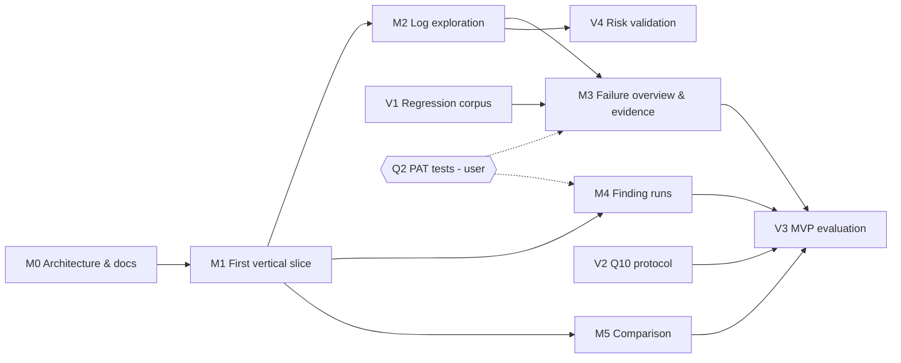

# Roadmap — GitHub Actions UI

**Status (2026-10-20):**
- **M0** (architecture and documentation): **complete**. `docs/ARCHITECTURE.md` and this roadmap were approved 2026-10-20.
- **M1** (first vertical slice): **complete**, accepted 2026-10-20.
  - Automated tests: 72 unit and contract tests, and 7 Chromium end-to-end tests.
  - Live smoke test: passed, run by the user with their own token.
  - Security follow-ups applied before acceptance: fixture mode is compiled out of production builds, and all unit tests fail closed on network access (ARCHITECTURE §11.2).
- **Fixture pin:** `184ede06780166a90bdb173adda9a23a5b6545c4`, recorded in `fixtures.lock.json`.
- **Repository:** `https://github.com/GauJosh/github-actions-ui`, **private**. Open source first is the intended direction. Publishing waits for a separate decision after the first vertical slice is reviewed.
- **Repository dashboard, pipeline explorer and release views** (requested 2026-10-20, ahead of the original M2–M5 order): implemented locally; design direction **approved** 2026-10-20; not yet committed.
  - Covers part of M4 (finding runs: repository list, run list with filters) and a new execution-graph view of each run.
  - Large multi-environment runs open on a release overview (phases → jobs), with focused phase views and the full graph as an alternative. Demo gallery of synthetic enterprise scenarios in fixture mode only.
  - Dependency edges come only from `needs:` in the workflow file at the run's commit. Details: ARCHITECTURE §11.3.
  - **Step-to-log navigation** (requested 2026-10-20): step mapping v2 with checks C1–C4, the risk flag and the "approximate" and "unavailable" states, implemented locally, **in review**, not committed (ARCHITECTURE §11.4). It covers M2 acceptance criteria 1 and 2.
  - **Nested reusable-workflow hierarchy** (requested 2026-10-20 after the first work trial): implemented and pushed (ARCHITECTURE §11.3).
  - **Essential logs and log exploration** (requested 2026-10-20): display modes, conservative classification, quick filters, search and failure-investigation controls (ARCHITECTURE §8, log display modes). Pushed.
  - **Failure detection and step-first logs** (requested 2026-10-21 after a work trial missed a Node.js failure): evidence tiers with failure signatures and stack traces, step headings with collapse, the failure evidence panel, scope and error navigation (ARCHITECTURE §8, error evidence tiers). Pushed.
  - **Environment grouping and grouped graph layout** (requested 2026-10-21 after promotion checks were grouped under DEV): environment provenance, same-name job matching, and one column per environment in the execution graph (ARCHITECTURE §11.3, environment evidence). Pushed.
  - **Run insights** (requested 2026-10-21): run statistics, execution timeline, workflow source explorer and per-run deployment records as DORA groundwork (ARCHITECTURE §11.5). Pushed. Historical metrics need the definitions listed there first.
  - **Workflow-adaptive graph and run attempts** (requested 2026-10-22): declared jobs with no job in the run are definition context, not nodes or phases; navigation between run attempts (ARCHITECTURE §11.6). Pushed.
  - **Failure impact explorer** (requested 2026-10-23, feature 1 of the failure-investigation spec): failures, their verified upstream, and downstream jobs blocked by GitHub's skip rules, shown on the execution graph (ARCHITECTURE §11.7). Committed in 22ae4e8 and pushed to the checkpoint branch `checkpoint/failure-investigation-2026-10-25`.
  - **Run comparison, pipeline-wide search, log comparison and classification** (requested 2026-10-23, features 2–4 of the same spec): Compare and Search views, the log diff, and classifier rules with regression cases (ARCHITECTURE §11.8). Committed in 22ae4e8 and pushed to the same checkpoint branch. Covers part of M5 (comparison); the M5 baseline tiers and its "no comparison" acceptance cases are not done.
  - **Run history** (requested 2026-10-25): a History view for a run with the last 20 runs of its workflow, a baseline of earlier successful runs, a duration chart, outcome counts and the slowest jobs (ARCHITECTURE §11.9). Committed in 28e42d6 and pushed to the checkpoint branch. Jobs are matched by name only, and queue time and approval waits are not separated.
  - **Deployment evidence for a run** (requested 2026-10-25, Release & Deployment Intelligence phases 1–2B): on request, the run page lists GitHub's deployments of the run's exact commit with each one's latest status (ARCHITECTURE §11.10). A deployment is "confirmed for this run" only when the commit matches and a deployment status links to this run; otherwise it is "same commit only", "conflicting" or "unknown". A failed status request is shown as unknown, not as "no status". Implemented and tested locally; committed in 55be270 (Checkpoint 1).
    - Limits: only the first 100 deployments of the commit and 100 statuses per deployment are read; deployments are per commit, not the repository's history.
    - Phase 2C (2026-10-26): each deployment row also says how it relates to this run's jobs for that environment: tied to a job only when a status link names it, otherwise confirmed for the run, a candidate, another run's, conflicting or unknown (ARCHITECTURE §11.10). Implemented and tested locally; committed in 55be270 (Checkpoint 1).
    - Phase 3A (2026-10-26): a pure model of GitHub Releases against the run's commit, with tags resolved through the Git references API responses, including annotated and nested tags (ARCHITECTURE §11.10). Model and tests only; committed in 55be270 (Checkpoint 1).
    - Phase 3B (2026-10-26): a read-only release loader with bounded tag resolution (10 releases, 20 tag requests, 2 at a time), cancellation, and a missing tag kept apart from a failed lookup (ARCHITECTURE §11.10). Loader and tests only; no view uses it yet; committed in 55be270 (Checkpoint 1).
    - Phase 3C (2026-10-26): "Load releases" in the deployments section lists releases confirmed for the run's commit, counts the rest by outcome, and names same-commit deployments without calling the release deployed (ARCHITECTURE §11.10). Committed in 55be270 (Checkpoint 1).
    - Phase 3D (2026-10-26): "Check the next N releases" resolves further batches with the same caps, reads older listing pages when needed, keeps earlier results and never repeats a lookup (ARCHITECTURE §11.10). Committed in 55be270 (Checkpoint 1).
    - Phase 4A (2026-10-26): artifact evidence researched: artifacts name their run, never an attempt, a release or a deployment (ARCHITECTURE §11.10).
    - Phase 4B (2026-10-26): a pure artifact evidence model and a read-only loader of the run-scoped listing (100 per page, at most 3 pages, `total_count` for completeness, deduplication by id, cancellation), with synthetic fixtures. Never downloads; no view uses it yet; committed in 55be270 (Checkpoint 1).
    - Phase 4C (2026-10-26): "Load artifacts" on the run page shows each artifact's metadata and tie to the run, the listing state, and whole-run wording for re-runs, including when an earlier attempt is viewed (ARCHITECTURE §11.10). Committed in 55be270 (Checkpoint 1).
  - **Shareable investigation reports** (requested 2026-10-26, Feature 5A): a pure, versioned report model (`gha-ui.investigation-report` v1) built only from evidence already loaded, with explicit section states, caveats and privacy rules (ARCHITECTURE §11.11). Model and tests; committed in Checkpoint 2 (Features 5A–5D).
  - **Export report action** (requested 2026-10-27, Feature 5B): an Export report button on the run page with a preview of every section's state, a validated JSON download (`report-<owner>-<repo>-<run>-attempt<N>.json`) built only from evidence the page already holds, and no request, upload or stored copy (ARCHITECTURE §11.12). Committed in Checkpoint 2 (Features 5A–5D).
  - **User-selected log excerpts** (requested 2026-10-27, Feature 5C): Add to report from a line range of an open, fully loaded log (one job and step per excerpt, read from the loaded log), limits refused rather than cut, long lines cut only after the user accepts, a line-by-line preview with masked text highlighted and Remove, and excerpts discarded when the run or attempt changes (ARCHITECTURE §11.13). Committed in Checkpoint 2 (Features 5A–5D).
  - **Excerpt boundaries from log rows** (requested 2026-10-27, Feature 5D): a keyboard-accessible ⋮ menu on each log line with Set as first line / Set as last line, filling the same excerpt form; the range is shown and shaded, reversed ranges are explained and cannot be added (ARCHITECTURE §11.13). Committed in Checkpoint 2 (Features 5A–5D).
  - M2's other log-exploration items (ANSI, groups, scaled scrolling, the worker cache) are still open. Q2 and Q10 remain open.
- **Containerized hosting** (approved 2026-10-28; Hosting track below): K1–K4 were implemented and verified locally on 2026-10-28, with a pre-commit audit (K5–K6). ARCHITECTURE A10–A12, §7.4 and §11.14.
  - K1 is the production image with a Node static server; K2 is the `charts/gha-ui` Helm chart, verified on Minikube; K3 adds documentation and CI chart validation.
  - The app is unchanged: browser-only, read-only, with the token in memory.
  - A backend, Gateway API access, GitOps examples and emergency execution are **not approved**. Each needs its own decision.
- Commits and pushes each need approval.

**References:**
- Scope and success criteria (S1–S7): the **project brief**, maintained locally and not published in this repository. The criteria this roadmap uses are restated where they are applied.
- Design: `docs/ARCHITECTURE.md`.

**Rules that apply to every milestone:**
- Read-only: no write API calls.
- No AI features, backend or persistence.
- The token is held in memory only.
- No tokens or signed URLs in code, tests, logs or docs. Diagnostics record hostnames only.
- Changes to the fixture repository:
  - verify each edited file first;
  - run the secret scan as a separate step before any push;
  - never chain edit, commit and push so that a failed step is skipped silently.
- Git operations (initialising, committing, pushing) and adding dependencies each need explicit approval.

## Tracks

| Track | Milestones | Purpose |
|---|---|---|
| **Architecture and documentation** | M0 | Agree on the design before any code |
| **First vertical slice** | M1 | Prove the riskiest path end to end: token → run → tail-first log in the worker → log view |
| **Subsequent MVP capabilities** | M2–M5 | Log exploration, failure overview and evidence, finding runs, comparison |
| **Evaluation** | V1–V4 | Regression corpus, held-out protocol (Q10), measurement against S1–S7, validation of open risks |
| **Hosting** (added 2026-10-28) | K1–K3 | Serve the unchanged app from a container and deploy it to Kubernetes with Helm |

---

## M0: Architecture and documentation (complete)

**Deliverables:**
- `docs/ARCHITECTURE.md`, with decisions A1–A9 (A8 provisional);
- this roadmap;
- the local project brief updated for consistency (not published);
- the reviewed architecture proposal, revision 3 (kept locally, not part of this repository).

**Acceptance criteria:**
- The user approves ARCHITECTURE.md and ROADMAP.md.
- The CSP wildcard risk, the untested range-refusal fallback, browser compatibility, larger-log memory and the step-mapping limitations are recorded as **open risks**, not as validated.
- Q2 and Q10 are recorded as open.
- No tokens or signed URLs appear in any document.

**Dependencies:** none.

---

## M1: First vertical slice — open a failed run and read its log tail-first (complete)

**Goal:** prove the core technical path in a thin slice:
- connect with a token, or use fixture mode;
- paste a run URL;
- see the failed jobs and steps from the API;
- open a failed job's log: tail evidence first, then the full log in the worker;
- view, scroll and search it, with every loader failure state explicit.

**In scope:**
- Project scaffold:
  - React 18, Vite, TypeScript, Vitest, Playwright;
  - lint rules for module boundaries;
  - the Apache-2.0 LICENSE.
- `auth`: `PatProvider` (memory only, Disconnect).
- `github`:
  - client for run, jobs and job log;
  - status codes mapped to domain states;
  - GET and HEAD only.
- Fixture fetch script and `fixtures.lock.json` (ARCHITECTURE §11.1): pinned to a commit SHA, with per-file SHA-256 checks, explicit failures, and an offline `--from` path.
- Fixture mode (A5) using the pinned fixtures, with the "Demo data" banner.
- `logs/download`, the full loader from ARCHITECTURE §6:
  - HEAD, tail, body and append;
  - backpressure;
  - retry and resume;
  - the `signed-url-rejected`, `interrupted`, `incomplete`, `cancelled` and `expired` states;
  - the A8 threshold;
  - A9 recovery with its restart limit;
  - completeness checks: byte counts and range continuity (not cryptographic verification; ARCHITECTURE §6.6).
- `logs/worker`: the chunked store, line index, CRC32, rows and substring search.
- `ui`:
  - Connect view;
  - run view listing failed jobs and steps from the API;
  - virtualised log view with tail lines shown first;
  - line deep links using the URL fragment, which never contains the token;
  - every loader state from ARCHITECTURE §9.
- CSP for the preview build, and the worker's `connect-src 'none'`.

**Out of scope:** step mapping, extraction and candidates, annotations, ANSI and groups, the run list and PR entry, comparison.

**Acceptance criteria:**
1. **Fixture mode, s09 failed run:**
   - the failed job and step are listed from API data;
   - tail lines are visible before the body download completes;
   - the full log loads and passes the completeness checks (byte count = `Content-Length`, contiguous ranges);
   - a regression test confirms the CRC32 equals the fixture reference. This is a loader-correctness check, not verification of the content;
   - the UI never labels a log "verified".
   - any line is reachable by scroll and by deep link;
   - substring search finds the known lines.
2. **Loader states** are covered by automated tests against a mock API and blob:
   - interrupted → resumed exactly;
   - repeated failure → `incomplete`, showing bytes received (the test also checks the prefix against the fixture reference CRC32);
   - 403 from the blob host → `signed-url-rejected` → retried;
   - 410 → expired;
   - cancel → resume;
   - 200 instead of 206 → full-stream fallback (mock only; recorded as unvalidated against GitHub);
   - backpressure keeps in-flight data at or below 8 MiB plus one chunk.
3. **A8:** a synthetic log above `LARGE_LOG_SOFT_LIMIT_BYTES`:
   - ends `tail-only` with the evidence visible;
   - shows search and steps as unavailable, with the reason;
   - loads fully only after "Load full log".
   - Changing the constant changes the behaviour with no other code change.
4. **A9:**
   - an injected worker failure shows "Reloading log after an internal error" with progress, and ends complete (the regression test also checks the fixture CRC32);
   - failures beyond `MAX_WORKER_RESTARTS` end in `processing-failed`, with "Retry" and "Open log on GitHub";
   - "Retry" recovers.
5. **Secrets hygiene**, by automated test:
   - the token is never in `localStorage`, `sessionStorage`, IndexedDB, the URL or console output;
   - a marker placed in the mock signed-URL query string never appears in console, diagnostics or error text;
   - diagnostics show the blob **host** only.
6. **Read-only:** a test asserts that only GET and HEAD are issued.
7. **CSP:**
   - the preview build loads logs under the ARCHITECTURE §7.3 policy;
   - the worker cannot `fetch`;
   - removing the blob host blocks the log fetch.
8. **Main-thread responsiveness** while loading s09 is recorded (long tasks and heartbeat lateness), as a non-blocking trend.
9. **Live smoke (manual, done by the user with their own token in the running app):** the same journey on a failed `gha-ui-fixtures` run.
10. **Fixtures:** the fetch script retrieves the files at the pinned SHA and checks each SHA-256.
    - Tests show that a hash mismatch, a missing file, an HTTP error and a branch name used as the pin each fail with an explicit message and no partial files.
    - Fixture-dependent tests fail (never skip) when fixtures are missing.
    - `--from <local clone>` works offline.

**Dependencies:**
- M0 approved.
- **Explicit user authorisation to start M1**, separately covering:
  - initialising Git;
  - installing dependencies;
  - writing application code.
- Fixture pinning is **decided**: a fetch script pinned to a commit SHA with SHA-256 checks (ARCHITECTURE §11.1). The pinned SHA must be chosen.
- Q2 does **not** block M1: fixture mode needs no token, and live smoke uses the user's own repository with the provisional permissions.

---

## M2: Log exploration

**In scope:**
- ANSI colours;
- `::group::` structure;
- head and tail navigation;
- opt-in regex search with a time budget;
- scaled scrolling above ~1.5M lines;
- step mapping v2 with checks C1–C4 and the runtime risk flag, and a step rail with the "step boundaries approximate" and "unavailable" states;
- an in-memory cache of live workers (at most 3, least recently used; an evicted log is re-downloaded).

**Acceptance criteria:**
1. **Mapping v2 on fixtures:**
   - passes every s16 assertion (pass and fail runs);
   - passes the generic checks on the whole fixture corpus;
   - the risk flag fires on start-action/end-action-stripped copies and on 0 real fixture jobs.
2. The "approximate" warning appears whenever a check or the flag trips. It is never suppressed, and the docs describe v2 as **corpus-validated only**.
3. A 1.7M-line synthetic log is navigable to any line with scaled scrolling.
4. ANSI and group rendering matches the fixture expectations.

**Dependencies:** M1.

---

## M3: Failure overview and evidence

**In scope:**
- the failure overview as the primary screen;
- annotations, aggregated;
- extraction `rules@v1`, run on failed step segments plus annotations;
- candidates labelled as **hypotheses**, with evidence type and a line link;
- the failed-step tail, always shown;
- cross-job grouping of identical candidates;
- R3 non-success classification, with "reason unknown";
- the supporting job graph;
- read-only deep links to GitHub.

**Acceptance criteria:**
1. On the regression corpus, extraction meets the fixture truths, and rule changes are gated by the regression suite.
2. The matrix scenarios (s03, KAI) each show one group listing the affected jobs (S3).
3. The s06 timeout is classified as timed out with its evidence. A case with no evidence shows "reason unknown".
4. No copy anywhere states a verified cause. A test asserts that the label "hypothesis" is present.
5. Annotations unavailable because of permissions show an explicit state.

**Dependencies:**
- M2 (segments).
- V1 (regression corpus).
- **Q2** for whether annotations need Checks: Read. The milestone can proceed with a degraded state if Q2 is still open.

---

## M4: Finding runs

**In scope:**
- a repository picker;
- a recent-runs list filterable by failure, branch and PR;
- pasting a PR URL to list the Actions runs at its head SHA;
- non-Actions checks listed as "Not supported: open on GitHub";
- "No Actions runs for this commit".

**Acceptance criteria:**
1. Each entry path reaches the overview in fixture mode.
2. Every unsupported or empty case renders its explicit state.
3. The request cost stays within the E3 budget (S7).

**Dependencies:**
- M1.
- **Q2** tests D1 and D2, which decide whether Pull requests: Read and Checks: Read are needed and what the onboarding copy says.

---

## M5: Comparison

**In scope:**
- baseline tier A (same branch), then tier B (default branch), then an explained "no comparison";
- a manual later-run option, labelled as such;
- copy for the same-commit case: "consistent with … not proof";
- the commit range, with a GitHub compare link;
- workflow-file change detection and a YAML diff;
- job and step outcome and duration deltas;
- "Inputs: not available from the GitHub API";
- R7 previous-run comparison, only when no baseline exists.

**Acceptance criteria:**
1. **S4 on input-only pairs:** s02–s06 and s08–s12 report "no change in commits or workflow file; inputs not available", with **zero causal claims**.
2. s13 detects the workflow change.
3. The KAI `main` failure shows "no comparison" and offers the later run, labelled as such.
4. The `inputs` field cannot be filled by inference (type-level and unit test).

**Dependencies:** M1. Not blocked by Q2.

---

## Evaluation track

### V1: Regression corpus

Re-express the six third-party log excerpts (local research material under the Q8 conditions; never committed or published) as **synthetic** fixtures in `gha-ui-fixtures`:
- `mypy-file-line-error`
- `pytest-collection-importerror`
- `rustc-error-code`
- `test-timed-out`
- `meson-probe-noise`
- `node-test-cross-mark`

Then delete the local excerpts.

**Acceptance criteria:**
- Each case is reproduced synthetically, with no third-party text.
- Every edited file is verified, and the secret scan runs as a separate step before the push.
- The local excerpts are deleted.

**Dependencies:**
- Needed before M3 rule work.
- User approval for the fixture-repo change.

### V2: Q10 held-out protocol

Write the protocol **before** any held-out set is drawn or inspected. It covers:
- the sampling frame and size;
- a draw procedure that can be reproduced but isn't seen until grading;
- the grading rubric;
- who grades, and blinding;
- storage and deletion under the Q8 conditions;
- single use: a set becomes regression material once it has been looked at.

**Acceptance criteria:** the user approves the protocol. Q10 is closed only then.

**Dependencies:** none, so it can run in parallel with M1–M5. It must finish before V3.

### V3: MVP evaluation (Phase 6)

Measure S1–S7 against the native UI on ≥15 corpus failures:
- S2a: evidence visibility;
- S2b: top-3 accuracy, on a fresh held-out set drawn under V2;
- S2c: cause identification, recorded per session.

**Acceptance criteria:**
- Results are recorded per criterion, with held-out and regression results reported separately.
- No tuning against the held-out set.

**Dependencies:** M3, M4, M5 and V2.

### V4: Validation of open risks

| Item | Acceptance criterion |
|---|---|
| Larger-log memory | Worker memory measured with the chunked store on at least two sizes above 44 MB (e.g. synthetic ~88 MB and ~176 MB). A8 threshold reviewed against the results. Memory is still not described as bounded unless a measurement shows it |
| Browser compatibility | Firefox and Safari checked for the logs redirect, HEAD, ranges, transfer and CSP. Results recorded; no claim before then |
| Range-refusal fallback | Remains mock-tested only. Recorded as unvalidated against GitHub unless a real refusal is ever observed |
| Hardware and network spread | Tail-evidence and full-load timings measured on at least one more machine or network |

**Dependencies:** M2 (the full loader and worker in the real app).

---

## Hosting (added 2026-10-28)

Containerized static hosting was approved on 2026-10-28 (ARCHITECTURE A10–A12). It deploys the existing app and does not change it: browser-only, read-only toward GitHub, with the token held in browser memory.

| Step | Scope | Status |
|---|---|---|
| **K1** | Production image (`deploy/ui/`): Node static server, security headers from their single source, root and path-prefix hosting, non-root and read-only | Implemented; verified locally (tests, Podman container) |
| **K2** | Helm chart (`charts/gha-ui/`): Deployment, Service, a ServiceAccount with no permissions, `helm test` | Implemented; verified on Minikube at `/` and `/gha-ui/` |
| **K3** | Architecture record, and a CI job that lints, renders and checks the chart's invariants | Implemented and run locally; **the CI job had not run on GitHub as of 2026-10-28** |
| **K4** | Integration review: the documented path repeated from a clean export of the tree, through Minikube install, test, upgrade, rollback and uninstall | Done locally (ARCHITECTURE §11.14); README and checker fixes; values schema tightened after the pre-commit audit |

**Acceptance criteria (K1–K3):**
- The same browser tests pass against the local server, the container and the Kubernetes Service, at both paths, with the log worker.
- Served headers match `tools/vite/security-headers.ts` exactly.
- `helm test` passes.
- CI renders and checks the chart without a cluster, registry or secrets.

**Possible next steps, each needing its own decision and approval:**
- External access with a Gateway API `HTTPRoute`, verifying that headers pass through unchanged (ARCHITECTURE §12).
- GitOps examples (Argo CD, Flux).
- A backend and its chart. This would revise the "no backend in v1" constraint (D3) and needs a threat model first.
- Recovery packages and emergency workflow execution. These would end the read-only constraint (D4) and are not approved.

## Not on this roadmap

These are scheduled only after the MVP is validated, and each requires its own decision:
- static hosting: *moved onto the roadmap on 2026-10-28* as containerized hosting (Hosting, above);
- OAuth login (U2);
- line-by-line log diff (stretch);
- v1.x candidates (incident correlation, flake hints, test-report parsing, opt-in session token persistence);
- the browser extension;
- the history product (U6).
